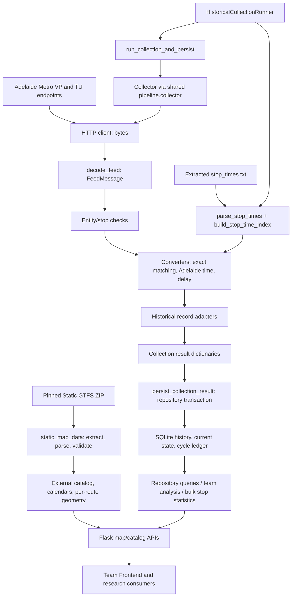

# Chenan Wang — GTFS Data Collection & Processing

INFO3901 Product Review, 9 November 2026. Reviewed 6 November against main
`0cbb2c7b3930b40cc0983903162340a25fc766ed`, including PR #72–75.
This document describes implemented code and evidence boundaries. CASR v2.1
remains **ON HOLD**. The accompanying branch changes comments/docstrings only.

## 1. Module Purpose and Client Requirements

CASR needs transport observations that researchers can retain, query and
interpret after a live feed has changed. My assigned module obtains Adelaide
Metro data, converts supported entities into consistent records and supplies
the historical database/analysis workflow. Automated collection captures
observations over time; it cannot retrospectively download missed feed cycles.

Static GTFS describes scheduled routes, stops, trips, stop visits and geometry.
GTFS-Realtime is a Protobuf feed of vehicle observations and service predictions.
Static metadata supplies the reference timetable; realtime predictions and
retained historical observations are different data products.

| Client need | Implemented contribution and acceptance boundary |
|---|---|
| Track vehicle observations | Fetch/decode/extract Vehicle Positions; downstream storage/playback consumes discrete coordinates, not guaranteed continuous trajectories. |
| Research predicted delays | Exact static visit matching and signed predicted-delay conversion; downstream metrics remain prediction-derived. |
| Retain research history | Database-ready adapters and persistence-aware runner integration; database schema/repository originated with the database owner. |
| Expand map coverage | Separate pinned static publisher supports 384 selected bus routes; historical coverage is independently measured. |
| Operate reliably | Retry/error classification, polling, logging, local transaction/recovery verification and handover; sustained CASR hardware operation remains unverified. |

### Contribution evidence and team boundaries

The following commits in main are attributed to `Alan-Wang00`, the Git identity
used for my work. Commit attribution and task descriptions support contribution
scope; they do not imply sole authorship of every line in a shared module.

| Work | Evidence and role |
|---|---|
| Sprint 1 SCRUM-86/87/88 | `167ce42`, `014eea1`, `59dcb37`: static parser, HTTP client and Protobuf decoder implementation. SCRUM-89/90 (`79bcedd`, `a9fad50`) added shared-format conversion/testing documentation. |
| Sprint 2 SCRUM-129–138 | Settings (`5db2a99`), scheduling (`1f4b0ab`), retrieval robustness (`ce55709`), validation (`1bd29d1`), historical adapters (`28816ff`), time edges (`fa12b88`), logging (`3ffbcbc`), reusable pipeline (`dd6bb58`), tests (`f19072b`) and handoff (`9cc759b`). |
| Later collection/storage integration | SCRUM-186/187 (`e314286`, `f3358e9`) extended persistence integration and historical runner. S4-DB01 (`5d2d7b7`) contributed storage optimisation on the shared database implementation. |
| Sprint 5 SCRUM-267/268 | Feed-wide validation was an investigation, not a new parser. `186d60d` rejects duplicate exact stop-time keys; [integration evidence](../../integration/sprint5-gtfs-integration.md) records validated versions and unresolved conflicts. |
| SCRUM-269/270 | `0b1f954`, `c08b900`: collection/access documentation and local reliability/recovery verification; these did not implement a new collector. |
| Supplementary Backend support | PR #72 `d531217`: Performance API filters; PR #73 `1ebe119`: selected static map publication; PR #74 `34e9624`: bounded bulk stop statistics. These support other members' areas. |

Lixuan's historical database foundation, Chengxi's delay metrics/classification/
Hotspot analysis, Pritish's Frontend, and Chenchen's integration/QA remain team
contributions. Git history shows these separate origins (for example database
`912c485`/`222cffe`, analysis `a1e5e84`/`694ea44`, and Frontend PR #75).
I do not claim their complete modules. No Jira service was queried for this
document; task IDs are corroborated by supplied responsibilities and Git subjects.

## 2. Main Features and Implemented Functionality

Paths below are relative to repository root.

| Component | Current implementation |
|---|---|
| Static CSV parsing | `backend/parsers/static_gtfs.py`: `parse_stops`, `parse_routes`, `parse_trips`, `parse_stop_times`; check required headers, preserve string IDs, convert selected numeric fields, accept UTF-8 BOM. |
| HTTP transport | `backend/realtime/client.py`: `GTFSRealtimeClient.fetch`; one urllib request, configured User-Agent/timeout, nonempty bytes, typed HTTP/connection/timeout failures. |
| Protobuf decoding | `backend/realtime/decoder.py`: `decode_feed`; bytes to generated `FeedMessage`, explicit wrong-type/empty/malformed-wire errors. |
| Supported entity checks | `backend/realtime/validation.py`: `is_valid_vehicle_position`, `is_valid_trip_update`, `is_valid_stop_time_update`; application field presence, not full GTFS compliance. |
| Mapping and conversion | `backend/services/gtfs_converter.py`: exact index, service-date timetable conversion, optional VP metadata and signed delay derived from feed arrival predictions. |
| Collection coordination | `backend/realtime/collector.py`: `collect_once`, `_fetch_with_retry`; Vehicle Positions and Trip Updates fetched sequentially, validated, converted and adapted. |
| Reusable boundary | `backend/realtime/pipeline.py`: `GTFSRealtimeProcessingPipeline.process_once` returns database-ready dictionaries; it does not persist. |
| Historical operation | `backend/services/historical_collection.py`: `load_stop_time_index`, `HistoricalCollectionRunner.initialise/run`; build one index and use the persistence-aware scheduler. |

CSV parsers read individual files, **not ZIP archives**. The static map publisher
opens the pinned ZIP in a temporary staging directory, then calls the parsers.
The historical runner expects extracted `stop_times.txt`; it does not download
static data or populate routes/stops/trips automatically. `extract_shapes` in
`recorded_map_data.py` streams requested geometry and is reused by the static
publisher rather than being part of the basic CSV parser.

Service Alert bytes can be fetched/decoded, but collection has no alert-history
adapter/table/API. A successful Protobuf parse does not prove semantic validity.

### Supplementary API and map support

`static_map_data.build_static_map_data` verifies the ZIP SHA-256 and version,
selects agency/type policy, validates cross-file relationships, preserves variants
and atomically publishes a new external directory. Feed 1710 publication selects
agencies 4/5/8 and route_type=3: 384 routes, 7,241 locations, 17,017 trips,
722,018 stop-times and 1,148 usable shapes. Type 712 is excluded; there is no
geographic boundary filter or per-day service selection. It never queries a DB.
See [citywide publisher contract](../../integration/citywide-static-map-data.md).

Performance endpoints accept timezone-aware inclusive observation bounds.
`backend/database/stop_delays.py::query_stop_delays` and
`backend/services/stop_delays.py::query_network_stop_delays` provide one bulk
request with average prediction delay, predicted on-time percentage, visit count,
availability and scope metadata. They reuse Chengxi's classification rather than
replace the analysis module. [The complete API contract](../../integration/network-stop-delays.md)
defines limits, fields and the distinction between stop membership and route scope.

## 3. System Architecture and Module Workflow



The arrows show calls/data dependencies, not simultaneous or atomic feed capture.
`process_once()` delegates to `collect_once()`. The historical runner instead
passes that pipeline's collector into `run_collection_and_persist()`, which calls
collection then `persist_collection_result()`. The repository owns the transaction;
the collector itself never opens SQLite. Static dictionary converters also support
explicit dimension insertion by integration consumers; automatic full dimension
loading is not part of runner startup.

`prepare_vehicle_position_record` and `prepare_trip_update_record` in
`historical_records.py` adapt the conversion result into the database contract.
Legacy `actual_arrival` names refer to predicted arrival values in this path.
Storage v2 represents scheduled/observed Trip Update times as UTC epoch seconds
and signed delay; a display value can be derived, not independently observed.
Vehicle Position timestamp storage is a separate TEXT contract.

## 4. Key Design Decisions and Reasons

- **Separate transport, decoding and conversion.** A urllib failure, malformed
  Protobuf body and unmatched static visit are different failure boundaries.
  Injectable clients/sleep functions permit deterministic offline tests.
- **Python and generated bindings.** Existing Python CSV, urllib, datetime,
  logging and SQLite facilities compose with GTFS Protobuf classes. This describes
  the implemented choice; no language benchmark or alternative-language trial is
  claimed. `ParseFromString` handles the wire format, not hand-written decoding.
- **Explicit request/retry policy.** Default timeout 10 seconds; two retries after
  the initial attempt, fixed five-second retry delay; polling wait defaults to
  60 seconds after a cycle. Connection/timeouts and HTTP 408/429/5xx are retried;
  permanent errors such as 403 are not retried immediately. The historical loop
  can attempt a later scheduled cycle. It is not fixed wall-clock scheduling.
- **Fail fast on ambiguous static keys.** `(trip_id, stop_id, integer sequence)`
  preserves repeated visits. Duplicate normalised tuples raise ValueError instead
  of choosing the last row; missing realtime exact keys are skipped, not guessed.
- **Separate processing and persistence.** Callers can test conversion without
  writing, while integration commits a cycle transactionally. Existing v2 state
  retention suppresses unchanged predictions and checkpoints at 900 seconds;
  it is not lossless raw-feed archiving or an actual-arrival log.
- **Pin publication identity.** Archive/payload hashes, version metadata and
  staging-to-new-folder publication make inputs auditable and prevent overwrites.
  IDs become hashed route filenames, not user-controlled paths. A hash is an
  identity check, not a signed endorsement by the feed publisher.
- **Keep versions explicit.** September recorded 1692 and static 1710 have separate
  artifacts and source selection. Geometry availability does not create matching
  historical observations; IDs must not silently join incompatible schedules.
- **Bound bulk statistics.** SQL uses the existing observed_at index, a 100,000-row
  time-slice guard and about five seconds of execution budget. Window functions
  select latest `(trip_id, stop_id, scheduled_arrival)` visits, then group by stop;
  grouped results alone enter Python. This avoids thousands of stop requests.
  Performance/Hotspot windows include the end; Vehicle History excludes it.

## 5. Important Assumptions and Limitations

1. The basic parsers check only required headers/conversions. They do not enforce
   all foreign references, uniqueness, coordinate finiteness/ranges or calendars.
   Publisher validation is stricter; callers must not equate parsing with full
   structural validation. The decoder also does not perform comprehensive
   Protobuf semantic/required-field verification after parsing.
2. Converter matching assumes a compatible static feed and exact upstream IDs.
   Runtime index loading does not enforce feed version, trip/route membership or
   service calendars. Validation requires a truthy stop_sequence, so zero is
   rejected by the current application policy. No policy change is made here.
3. Feed 1692 is valid 20 August–11 October 2026; 1710 covers 16 October 2026–
   9 April 2027. The intermediate 12–15 October static feed is unavailable.
   Saved 1710 investigations found sequence conflicts; no global offset,
   trip/stop-only fallback or terminal-999 reinterpretation is approved.
4. The earlier malformed backup and the later Box replacement are different
   evidence objects. Internal replacement validation passed integrity_check;
   this documentation task neither opens that database nor repeats production
   scans. Integrity alone does not verify collection continuity or matching.
   Older SCRUM-269 text is a historical baseline, not current citywide/API status.
5. Prediction visits are not actual completed services. Repeated retained states
   require analysis deduplication; observations can be sparse and unmatched.
   The saved 15-minute October bulk check had only 11 available stops at
   min_samples=10, 4,421 insufficient and 2,808 eligible stops without data.
   The default threshold remains unchanged. Static scope matches stop IDs;
   without route_id it includes all stored routes at eligible stops.
6. Local tests cannot prove actual CASR Task Scheduler configuration, power-loss
   recovery, uptime or production concurrency. Retry is bounded, there is no
   backfill/durable failed-cycle queue, and no complete Service Alert history.
7. PR #75 frontend integration is now in main; it does not imply this task has
   verified October E2E or rendering performance. Main still contains a fixed
   +09:30 playback conversion; October requires +10:30. Frontend acceptance and
   teammate-owned fixes remain separate. **v2.1 stays ON HOLD.**

## 6. Testing Methods and Results

Tests use unittest/pytest, mocked urllib responses, generated Protobuf messages,
injected clients/sleep functions, synthetic GTFS CSVs and temporary SQLite files.
They do not require live collection or private production databases.

| Method | Concrete checks |
|---|---|
| Parser/unit tests | Missing file/header, invalid numeric values, preserved IDs and optional fields. |
| Mocked HTTP | Configured User-Agent/timeout, bytes, empty body, HTTP status and connection/timeout classification. |
| Decoder | Serialise a synthetic FeedMessage, decode it, reject non-bytes/empty/invalid wire data. |
| Conversion/validation | Exact lookup, duplicate normalisation, repeated stop visits, missing fields, >24-hour GTFS time, signed delay and timezone cases. |
| Integration | Parser → index → injected realtime pipeline → adapters → temporary SQLite; invalid/mismatched cases remain explicit. |
| Reliability | Controlled retries, rollback, state/checkpoint retention, backup/recovery and launcher/mutex cases; local scope only. |
| API regression | Existing Performance/Hotspot parity, inclusive bounds, DST offsets, deterministic latest visits, static/observed scope and limits. |
| Static publisher | Pinned inputs, relationships, variants, bad references/coordinates, atomic no-overwrite and source separation. |

Fresh documentation-branch result: **339 passed in 50.23 seconds, zero failures/skips**. The exact selected-suite
command is reproducible from the following test-file list:

```powershell
$files = @(
  'test_static_gtfs', 'test_realtime_client', 'test_realtime_decoder',
  'test_realtime_collector', 'test_realtime_validation', 'test_gtfs_converter',
  'test_gtfs_time_edges', 'test_gtfs_integration', 'test_realtime_processing_pipeline',
  'test_historical_records', 'test_realtime_logging', 'test_historical_collection_runner',
  'test_historical_reliability', 'test_historical_deployment',
  'test_historical_storage_optimisation', 'test_static_map_data',
  'test_recorded_map_data', 'test_stop_delays', 'test_performance_time_filters',
  'test_api', 'test_hotspots', 'test_analysis', 'test_database_repository', 'test_pipeline'
) | ForEach-Object { "backend/tests/$_.py" }
python -m pytest @files tests/test_analysis_integration.py tests/test_database_analysis_integration.py -q -p no:cacheprovider
git diff --check
```

Use the project's Python environment with its testing dependencies. In this
Windows validation, pytest came from an existing external test-dependency folder;
the application environment was not reinstalled. AST comparison with main after
removing docstrings verifies unchanged executable Python structure; relative
Markdown links and English text were also checked. No coverage percentage or
whole-project test total is inferred from this selected suite.

Historical evidence is separately labelled: [SCRUM-270 reliability](../historical-collection-reliability.md)
records 117 targeted tests and supplemental experiments; [Stop Delay handover](../../integration/network-stop-delays.md)
records 202 regression tests including 41 new cases. [Chenchen's integration report](../../testing/sprint5-final-integration-test-report.md)
records a separate 356-test main run and subsequent 41-case Stop Delay check.
Counts from different runs overlap and must not be added. Full-network publisher
validation covered 384 routes; the later 1,563 per-file/per-route assertions were
checks, not 1,563 pytest test cases.

## 7. Major Bugs, Fixes and Remaining Issues

| Problem → cause | Fix/investigation → verification |
|---|---|
| Duplicate static visit overwrote a dictionary entry → identical normalised tuple | SCRUM-268 `186d60d` rejects duplicates; exact/normalised duplicate fixtures and valid repeated-visit integration tests verify the behaviour. |
| Historical Performance ignored requested time bounds → endpoint did not forward filters | PR #72 forwards validated aware bounds, preserving fractional-second repository precision; future empty-window, route/stop isolation and UTC/DST tests verify it. This is supplementary integration support. |
| Citywide static route had no recorded demo artifact → demo publisher/reader intentionally covers three routes | PR #73 adds a separate pinned static publication and source contract; no-history geometry, source precedence and recorded regression tests verify it. |
| Insufficient predictions risk misleading map values → raw retained revisions are not independent visits | PR #74 adds bounded latest-visit bulk metrics, null insufficient fields and scope metadata; single-stop parity, row/deadline guards and no-data tests verify it. |
| HTTP 403/access failure | Initial client commit already sets a User-Agent; current tests verify headers and no immediate 403 retry. Repository evidence reviewed here does not establish that a header change alone fixed a particular live 403. Do not claim a reproduced production access fix. |
| 1710/realtime sequence mismatch | Investigated and documented, not fixed. Saved snapshot evidence reports 1,635 exact matches and 58 conflicts. Duplicate rejection does not resolve producer semantics; release remains blocked. |
| Missing static dimensions / malformed backup | Investigated as distinct issues. Empty dimension tables can block metadata-dependent queries; corruption cannot be repaired by importing dimensions. Preserve failing source and verify a separately supplied backup. |

The comment audit also found a stale collector docstring saying validation
belonged to a later task; it now describes existing validation. Potential broader
parser/semantic-validation gaps above are reported, not silently repaired.

## 8. Third-Party Libraries and External Data Sources

| Dependency | Verified repository declaration/use |
|---|---|
| `gtfs-realtime-bindings==2.2.0` | Pinned in requirements.txt and requirements-collector.txt; provides google.transit.gtfs_realtime_pb2. |
| `protobuf==7.36.0` | Pinned in both files; wire parser and DecodeError. Pin declaration is not a claim of newly testing a clean install. |
| `tzdata` | Declared without a version pin; supplies IANA timezone data where the OS lacks it. |
| `Flask`, `flask-cors`, `jsonschema` | Unpinned in requirements.txt; API/CORS and schema testing. Not required by the basic HTTP/decoder alone. |
| Python standard library | csv/pathlib/zipfile/tempfile/hashlib/json; urllib; datetime/zoneinfo; logging/time; sqlite3. requests is not used by this HTTP client. |
| pytest / unittest.mock | Test tooling; pytest is not pinned in the root runtime requirements. unittest and mock are standard library facilities. |

External references (reviewed 6 November; live feeds were not collected):

- [Adelaide Metro developer information](https://www.adelaidemetro.com.au/developer-info):
  official static/realtime access and attribution guidance. Attribute
  Adelaide Metro – Department for Infrastructure and Transport, South Australia.
- [Adelaide Metro realtime API](https://gtfs.adelaidemetro.com.au/): repository
  config uses `https://gtfs.adelaidemetro.com.au/v1/realtime/vehicle_positions`,
  `/trip_updates` and `/service_alerts` under the same realtime prefix.
- [GTFS Schedule reference](https://gtfs.org/documentation/schedule/reference/)
  and [GTFS-Realtime reference](https://gtfs.org/documentation/realtime/reference/):
  CSV relationships and FeedMessage/entity definitions. The implementation uses
  a subset; this document does not claim full specification compliance.

Further repository detail: [processing architecture](../gtfs-processing.md),
[historical collection/access guide](../../handover/casr-gtfs-data-collection-and-access.md)
(historical status caveats noted above), and [Windows collector guide](../../deployment/windows-historical-collector.md).
