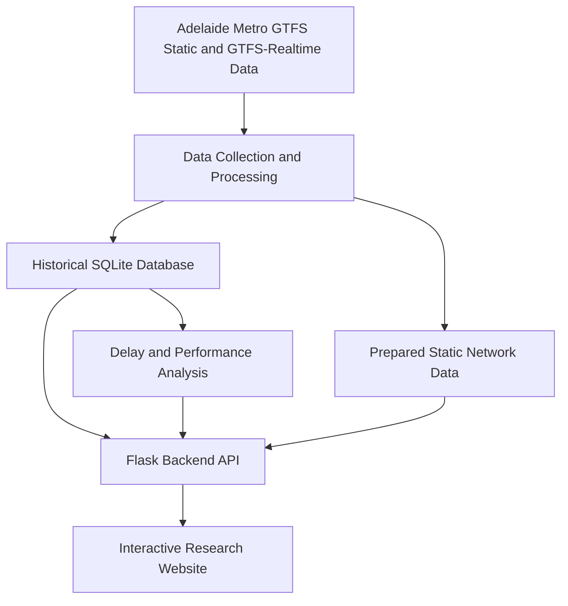

# Adelaide Metro Transport Analysis — Final System Design

**Client:** Centre for Automotive Safety Research (CASR)  
**Project Team:** UG-S2-15  
**University:** The University of Adelaide  
**Date:** 8 November 2026  
**Document Type:** Final Integrated System Design

---

## 1. Introduction

### 1.1 Project Background

Adelaide Metro Transport Analysis is a web-based research platform developed for the Centre for Automotive Safety Research (CASR).

The project addresses a practical research challenge: Adelaide Metro provides valuable transport information through GTFS and GTFS-Realtime data, but large datasets are difficult to collect, preserve, interpret and explore directly.

Researchers need more than access to raw records. They need to understand the transport network, examine past vehicle movements, compare service performance and identify locations where delays frequently occur.

Our team designed an integrated platform that transforms transport records into accessible historical analysis and interactive visual information.

The final product combines data collection, historical storage, performance analysis and geographic visualisation within one research-oriented system.

### 1.2 Purpose of This Document

This document explains the overall design of the final system, focusing on:

- How the design responds to CASR's research requirements.
- Why the selected architecture and technologies were appropriate.
- What methods were used to process and analyse transport data.
- How the five main modules work together.
- How the design was evaluated.
- What limitations remain and how the system could be extended.

Detailed implementation information and module-specific testing are provided in the individual design documents linked at the end.

### 1.3 Design Objectives

The project was designed to achieve five main objectives:

1. Make Adelaide Metro network information easier to explore.
2. Preserve historical transport observations for research.
3. Support meaningful delay and punctuality analysis.
4. Present complex results through an interactive website.
5. Deliver a maintainable system that CASR can reproduce and extend.

The product is intended for historical transport analysis rather than continuous live vehicle tracking.

---

## 2. Understanding CASR's Requirements

### 2.1 Client Needs

The team's initial requirements and subsequent client discussions identified three major research needs.

#### Historical Data Accessibility

Realtime transport information changes continuously. Without historical storage, researchers cannot reliably return to earlier observations.

CASR therefore needs a system that retains transport records and makes them accessible for later investigation.

#### Service Performance Analysis

Raw arrival predictions and vehicle records do not directly explain transport reliability.

Researchers need understandable performance measures that allow them to investigate delays, compare routes and stops, and identify recurring problem locations.

#### Clear and Accessible Visualisation

A large transport database is difficult to interpret through tables or raw data alone.

Researchers need an interactive interface that connects statistical results with actual routes, stops and geographic locations.

### 2.2 Requirements-to-Design Mapping

| CASR Research Need | Design Response | Expected Research Value |
|---|---|---|
| Explore the Adelaide Metro network | City-wide static map | Understand route and stop locations |
| Examine previous transport activity | Historical data collection and storage | Revisit recorded observations |
| Compare route and stop performance | Delay and punctuality analysis | Identify differences in predicted service performance |
| Find locations with recurring delays | Historical delay hotspot analysis | Prioritise areas for further investigation |
| Understand vehicle movement over time | Historical vehicle playback | Review recorded vehicle activity |
| Explore complex data efficiently | Integrated interactive website | Reduce the need to inspect raw records manually |
| Reuse information in further research | Historical queries and data export | Support additional analysis outside the website |

### 2.3 How Requirements Influenced the Design

The client requirements directly shaped our design decisions.

Because researchers need historical information, we designed persistent storage rather than relying only on realtime feed requests.

Because researchers need performance comparisons, we introduced a separate analysis module with consistent delay calculations and aggregation methods.

Because researchers need accessible results, we selected a map-based interface that allows them to explore transport information spatially.

Because CASR may continue using or extending the project, we kept the major system components separate and documented their responsibilities.

This requirements-driven approach helped the team prioritise research value over unnecessary interface or technical features.

---

## 3. Overall System Design

### 3.1 Design Approach

The team adopted a modular system architecture.

Instead of placing all responsibilities in one application component, we separated the project into five connected areas:

1. GTFS data collection and processing.
2. Historical database and querying.
3. Delay and performance analysis.
4. Backend integration.
5. Interactive frontend visualisation.

This design supports independent development, easier testing and clearer maintenance responsibilities.

It also allows changes to individual modules without redesigning the entire application.

### 3.2 System Architecture

**Figure 1. High-level system architecture**

The diagram represents the main logical relationships between the system components.

Static GTFS preparation and realtime historical collection are separate processes. The prepared static network can be used by the website independently of the historical database.

### 3.3 Why This Architecture Was Selected

The architecture was designed around three priorities.

**Separation of responsibilities**

Each module performs a specific role. Data collection prepares records, the database preserves them, analysis calculates metrics, and the frontend presents information.

This reduces unnecessary dependencies between components.

**Maintainability**

The system can be updated as transport data, research requirements or interface needs change.

For example, the analysis module can be improved without redesigning the map interface.

**Independent verification**

Separating modules allows the team to test their behaviour individually before testing complete user workflows.

This was particularly important because different team members were responsible for different parts of the system.

### 3.4 Technology Selection

| Technology | Design Reason | Consideration |
|---|---|---|
| Python | Supports GTFS processing and data analysis | Requires a configured Python environment |
| SQLite | Provides persistent relational storage without a separate database server | Large historical queries require careful management |
| Flask | Connects data and analysis services to the website | Requires a running backend process |
| JavaScript | Supports interactive browser behaviour | Frontend and backend interfaces must remain consistent |
| Leaflet | Supports interactive maps and geographic layers | External map resources may require internet access |
| GitHub | Supports collaborative development and version control | Large datasets must be managed separately |

The technologies were selected for their suitability for a research prototype, ease of integration and maintainability.

The team did not require a complex distributed infrastructure to deliver the agreed research functionality.

---

## 4. GTFS Data Collection and Processing Design

**Primary Contributor: Chenan Wang**

### 4.1 Design Objective

The data collection module was designed to obtain and prepare Adelaide Metro transport information for historical research and map visualisation.

CASR needs reliable access to transport observations, but realtime feeds contain changing information that must be processed before it can be stored or analysed.

The design therefore separates data retrieval, decoding, validation and conversion.

### 4.2 Data Sources

The system uses two complementary data sources.

**GTFS Static**

Provides scheduled transport information, including:

- Routes and stops.
- Trips and stop times.
- Scheduled route geometry.
- Service calendar information.

**GTFS-Realtime**

Provides changing transport observations, including:

- Vehicle Positions.
- Trip Updates and arrival predictions.

The system does not treat these sources as interchangeable.

GTFS Static describes the scheduled network, while GTFS-Realtime provides observations recorded during particular periods.

### 4.3 Data Processing Method

The processing workflow follows four main stages.

**Collection**

Relevant GTFS data is retrieved from the available transport data sources.

**Validation**

The system checks whether the received information can be interpreted using supported data structures.

**Conversion**

Supported records are transformed into consistent internal representations.

Trip Update information is matched with timetable references where possible to support scheduled-versus-predicted arrival comparisons.

**Storage or Publication**

Historical observations are passed to the database, while prepared static information is made available for map visualisation.

### 4.4 Key Design Decision: Separate Static Network and Historical Coverage

During development, the team identified an important difference between static network coverage and available historical records.

The static GTFS publication can represent a large city-wide network, but the historical database may only contain recorded observations for a subset of routes and periods.

To address this, the design uses a prepared static map catalog separately from the historical database.

The verified static catalog includes:

- 384 selected bus routes.
- 7,241 stops or locations.
- 1,148 usable route shapes.

This allows researchers to explore the network even when historical performance information is unavailable for a particular route.

### 4.5 Research Value

This module provides the foundation for the rest of the system.

Without consistent data processing, historical analysis could contain incompatible identifiers, missing timetable references or incorrectly interpreted observations.

The design supports CASR's requirement for reusable transport data while preserving the distinction between scheduled services and historical records.

### 4.6 Design Limitations

- Historical observations depend on successful collection.
- Missed collection periods cannot automatically be reconstructed.
- Some realtime records may not match available static timetable information.
- Static network coverage does not guarantee equivalent historical coverage.

Detailed design: [GTFS Data Collection and Processing](chenan-gtfs-data-collection-design.md).

---

## 5. Historical Database Design

**Primary Contributor: Lixuan Zhang**

### 5.1 Design Objective

CASR needs to examine transport activity after the original realtime information is no longer available.

The database module was therefore designed to preserve historical observations and support research queries over different routes, stops, vehicles and time periods.

### 5.2 Storage Method

The team selected a relational database design using SQLite.

The system stores structured information about transport entities and historical observations.

The main historical records include:

- Trip Updates.
- Vehicle Positions.
- Relevant trip and timetable references.
- Collection information.

A relational structure was selected because it supports organised storage and filtered queries using identifiers and timestamps.

### 5.3 Historical Query Design

Researchers may investigate transport performance at different levels.

For example:

- A specific route over a historical period.
- A particular stop and its recorded predictions.
- A vehicle's recorded positions.
- A comparison across selected time intervals.

The database therefore supports queries that combine identifiers and time filters.

These queries supply information to the analysis module and the frontend through the backend.

### 5.4 Key Design Decision: Optimising Repeated Records

Realtime feeds may return the same prediction repeatedly.

Storing every unchanged observation without distinction would increase database size while adding limited new information.

The historical storage design therefore preserves meaningful prediction changes and periodic checkpoints.

This approach reduces unnecessary repetition while retaining information useful for historical analysis.

However, the resulting records must still be interpreted carefully. An observation count is not necessarily the number of unique completed services.

### 5.5 Key Design Decision: Using SQLite

SQLite was chosen because it offers:

- Persistent local data storage.
- Structured SQL queries.
- Simple deployment without a separate database server.
- Compatibility with the project's Python backend.

For a university research prototype, these benefits reduced installation and maintenance complexity.

The trade-off is that a database containing millions of observations still requires controlled queries, indexes and attention to storage growth.

### 5.6 Research Value

The database turns temporary transport feeds into a reusable research resource.

It supports historical performance analysis, vehicle playback and filtered data exports for further investigation.

This directly responds to CASR's requirement to access historical rather than only current transport information.

### 5.7 Design Limitations

- Historical completeness depends on collection coverage.
- Database size increases as more observations are retained.
- Historical predictions are not necessarily confirmed actual arrivals.
- Static and historical data may contain different route coverage.
- Long-term production storage and recovery require separate operational management.

Detailed design: [Historical Database and Query Module](lixuan-historical-database-design.md).

---

## 6. Delay and Performance Analysis Design

**Primary Contributor: Chengxi Huang**

### 6.1 Design Objective

Raw transport timestamps are not sufficient for researchers to understand service performance.

The analysis module was designed to transform historical timing information into consistent delay measures, punctuality categories and location-based comparisons.

This supports CASR's need to investigate service reliability and identify areas requiring further research.

### 6.2 Delay Calculation Method

The fundamental measure is the difference between an arrival-related timestamp and its scheduled arrival time.

**Delay in minutes = (Arrival time − Scheduled arrival time) / 60**

The result is interpreted as:

- A negative value indicates an earlier arrival or prediction.
- Zero indicates the scheduled time.
- A positive value indicates a later arrival or prediction.

For historical Trip Updates, the arrival value may represent a prediction rather than a confirmed actual arrival.

### 6.3 Punctuality Classification

The analysis module uses the following implemented categories:

| Classification | Delay |
|---|---|
| Early | Less than 0 minutes |
| On Time | 0 to 5 minutes |
| Delayed | More than 5 and up to 10 minutes |
| Severely Delayed | More than 10 minutes |

These are the thresholds implemented in the analysis module. They are project-defined analytical categories, not independently verified regulatory standards.

The categories allow researchers to interpret delay results more consistently.

### 6.4 Performance Measurement Methods

The module calculates several complementary measures.

**Average Signed Delay**

Measures the average difference from schedule.

Both early and late observations contribute, so negative values can offset positive values.

**Average Positive Delay**

Measures the average delay among observations with positive delay values.

This provides additional information that may be hidden by the signed average.

**Punctuality Rates**

Calculate the percentage of observations in the defined early, on-time, delayed and severely delayed categories.

**Observation Counts**

Show how much historical information supports the reported results.

These measures are used together because no single metric fully describes transport performance.

### 6.5 Historical Delay Hotspot Method

CASR also needs to understand where significant delays occur.

The hotspot analysis groups available delay observations by stop and calculates relevant performance measures.

Eligible stops are then ranked using factors including:

1. Severe delay percentage.
2. Total late percentage.
3. Average positive delay.
4. Number of severely delayed observations.

The implemented default minimum sample threshold is 10 observations.

This reduces the risk of highlighting a location based on only one or two records.

However, the threshold does not establish statistical significance or equal historical coverage between stops.

### 6.6 Key Design Decisions

**Consistent calculation methods**

Using shared delay calculations ensures different parts of the system apply consistent analytical rules.

**Multiple performance indicators**

Combining delay averages, categories and observation counts provides more context than a single average.

**Minimum sample requirements**

Distinguishing insufficient evidence from available performance results helps researchers avoid overinterpreting limited data.

**Separation from data storage**

The analysis module operates on structured records supplied by the database rather than controlling data collection directly.

This supports independent testing and future analytical extensions.

### 6.7 Research Value

The analysis module converts historical records into information that CASR researchers can compare and interpret.

It supports investigation of delayed services, differences between locations and recurring delay patterns.

### 6.8 Design Limitations

- Results may be based on predicted rather than confirmed arrivals.
- Retained observations do not necessarily represent unique services.
- Missing observations must not be interpreted as punctual services.
- Different levels of historical coverage can affect comparisons.
- The selected classification and sample thresholds may need refinement for specific research questions.

Detailed design: [Delay and Reliability Analysis](chengxi-delay-analysis-design-final.md).

---

## 7. Frontend and User Experience Design

**Primary Contributor: Pritish Reddy**

### 7.1 Design Objective

CASR researchers need an accessible way to explore data without directly querying a database or manually interpreting large datasets.

The frontend was designed around an interactive map supported by analysis controls and information panels.

The main objective was to connect transport performance information to its geographic context.

### 7.2 Map-centred Design Approach

The map serves as the main research interface.

Researchers can select routes and stops and view related information without changing between separate software tools.

A geographic interface was selected because transport performance is strongly associated with locations, routes and movement.

The map makes these spatial relationships easier to examine.

### 7.3 Main User Workflows

#### Exploring the Network

Users can select routes, examine route geometry and inspect stops.

This supports understanding of the scheduled Adelaide Metro network.

#### Reviewing Route and Stop Performance

Users can select a route or stop to view available historical performance statistics.

This connects numerical analysis to specific transport services and locations.

#### Exploring Network-wide Predicted Delays

The website uses map-based visual categories to communicate historical prediction-delay information.

It distinguishes recorded performance from insufficient or unavailable data.

This is important because missing observations must not be confused with good performance.

#### Identifying Delay Hotspots

A ranked list and map markers help researchers locate areas with significant recorded delay patterns.

The combination of rankings and geographic markers allows both statistical and spatial investigation.

#### Historical Vehicle Playback

Users can select a historical route and time period to examine recorded vehicle-position observations.

Playback allows researchers to review how the recorded positions change over time.

It does not reconstruct a guaranteed continuous vehicle trajectory.

#### Finding Nearby Stops

Nearest-stop lookup supports exploration of nearby transport infrastructure from a selected map location.

Distances are straight-line estimates rather than road or walking distances.

### 7.4 User Experience Design Decisions

**One integrated website**

Combining related functions reduces the need to switch between separate tools.

**Interactive selection**

Route and stop selection lets researchers focus on specific areas rather than view all information simultaneously.

**Visual separation of information**

Map layers and analysis panels distinguish network information, performance results, hotspots and historical movement.

**Clear data states**

Loading, missing-data and insufficient-data states are treated differently from valid analytical results.

**Historical time selection**

Time filters support investigation of recorded periods and require appropriate handling of Adelaide's local time and daylight-saving changes.

### 7.5 Research Value

The frontend makes the underlying system accessible to researchers who may not need to work directly with Python, SQL or raw GTFS files.

It provides a clearer way to investigate transport patterns and communicate findings visually.

### 7.6 Design Limitations

- Very large map datasets can affect browser performance.
- Online map resources depend on internet access or cached resources.
- Historical views depend on available observations.
- Some advanced interactions and unusual browser states require further verification.
- Visualisation does not remove the analytical limitations of the underlying data.

Detailed design: [Frontend Map and Visualisation](pritish-frontend-map-design.md).

---

## 8. System Integration and Quality Assurance

**Primary Contributor: Chenchen Zhang**

### 8.1 Integration Objective

The five modules were developed with different responsibilities, but the client requires one working product.

System integration was therefore designed to ensure that collection, storage, analysis and visualisation work together through consistent interfaces.

The main quality objective was not simply to confirm that individual components existed, but to verify that researchers could complete meaningful workflows through the website.

### 8.2 Integration Method

The team followed an incremental integration approach.

**Independent development**

Team members implemented and tested their assigned modules.

**Interface alignment**

The team documented how components exchange identifiers, timestamps and performance information.

**Backend verification**

Historical database queries and analytical results were checked before relying on the frontend display.

**Browser verification**

The team tested complete interactions, such as selecting a route, viewing its statistics and loading historical observations.

**Regression testing**

Automated tests were repeated after important changes to help identify unintended effects.

### 8.3 Requirements-based Testing

Testing focused on whether the delivered product supported CASR's research tasks.

| Research Task | Verification Approach |
|---|---|
| Explore the city-wide network | Load the map and select routes and stops |
| Investigate route performance | Compare displayed statistics with backend results |
| Examine stop performance | Select a stop and review historical metrics |
| Find delay hotspots | Load ranked locations and inspect map markers |
| Review historical movement | Load recorded vehicle positions and advance playback |
| Find nearby stops | Test map-based nearest-stop lookup |
| Reproduce the application | Check dependencies, data paths and startup procedures |

This approach connected testing evidence to the client's expected use of the product.

### 8.4 Important Integration Challenge

One significant issue occurred when historical playback initially failed to load selected CASR v2 routes.

The team investigated the relationship between the historical database and the static route information.

The historical database contained recorded vehicle positions, but some static route records were not present in its corresponding tables.

The backend was updated to support the relevant historical observations without relying solely on those missing static records.

The frontend was also updated to interpret historical Adelaide time selections correctly.

Following these changes, historical playback loading and timeline progression were verified.

This demonstrated the importance of testing the system using the actual supplied data rather than assuming all databases have identical coverage.

### 8.5 Verification Results

The team's final recorded automated regression test on 7 November 2026 reported:

**415 tests passed in 96.27 seconds.**

Browser testing also verified the main integrated workflows, including:

- City-wide network display.
- Route and stop selection.
- Performance statistics.
- Historical delay hotspots.
- Network-wide prediction delays.
- Nearest-stop lookup.
- Historical vehicle playback loading and progression.

The complete automated result does not mean every browser interaction or deployment environment has been independently verified.

### 8.6 Documentation and Reproducibility

The final documentation includes:

- A project README.
- A client installation and user guide.
- Individual module design documents.
- A final integration test report.
- Data collection and operational documentation.

The installation instructions explain the required external datasets and the process for running the website.

Keeping large historical datasets outside GitHub also prevents the source repository from becoming dependent on locally stored research files.

### 8.7 Research Value

The integration and QA process provides evidence that the individual modules can work together as a usable research platform.

It also makes the project easier for CASR to understand, reproduce and continue developing.

Detailed design: [Integration and Quality Assurance](chenchen-integration-and-qa-design.md).

---

## 9. Evaluation of the Final Design

### 9.1 Evaluation Against Client Requirements

The final design can be evaluated by comparing the client's research needs with the delivered capabilities.

| Client Requirement | Design Outcome | Evaluation |
|---|---|---|
| Accessible transport network information | Interactive city-wide map | Implemented and verified |
| Access to recorded historical observations | Historical SQLite database and queries | Implemented and tested |
| Delay and punctuality comparison | Performance analysis module | Implemented and tested |
| Identification of problematic locations | Delay hotspot analysis | Implemented and verified |
| Historical vehicle movement exploration | Recorded vehicle playback | Loading and progression verified |
| Easier research data exploration | Integrated browser interface | Main workflows verified |
| Reproducible project delivery | README, user guide and design documentation | Documented; independent setup verification remains important |

### 9.2 Strengths of the Design

**Client-focused functionality**

The major features correspond to identifiable research requirements rather than unrelated technical additions.

**Integrated research workflow**

Researchers can connect geographic information with historical performance and recorded movement.

**Modularity**

Data collection, storage, analysis and visualisation can be maintained and tested separately.

**Historical data reuse**

Recorded observations can support later investigation rather than being available only during realtime collection.

**Transparent limitations**

The design recognises the difference between historical predictions, actual observed arrivals and missing data.

### 9.3 Main Design Trade-offs

| Design Choice | Benefit | Trade-off |
|---|---|---|
| SQLite storage | Simple local deployment | Requires management of large historical datasets |
| Separate static and historical data | Wider network visualisation | Historical coverage can differ from map coverage |
| Prediction-based delay analysis | Uses available GTFS-Realtime information | Does not always measure confirmed actual arrival times |
| Map-based interface | More accessible geographic exploration | Large layers can affect browser responsiveness |
| Modular architecture | Easier testing and maintenance | Requires consistent interfaces between modules |
| Locally configured datasets | Flexible research setup | Users must obtain and configure the required data |

These trade-offs were considered acceptable for the project's research prototype scope.

---

## 10. Limitations and Future Development

### 10.1 Historical Data Availability

Historical analysis depends on the periods successfully recorded in the database.

Not every route, stop or date has complete observation coverage.

Future work could improve collection continuity and expand the available research history.

### 10.2 Reliability Interpretation

Prediction-derived delays should not automatically be interpreted as confirmed actual arrival performance.

Future research could investigate stronger methods for measuring completed services and validating prediction accuracy.

### 10.3 Statistical Interpretation

Hotspot rankings depend on available samples and selected thresholds.

Future extensions could introduce confidence measures, additional comparisons and methods for handling uneven observation coverage.

### 10.4 User Experience

Further work could improve accessibility, map readability, responsiveness and interaction testing.

Additional verification would be useful for playback Reset, route switching during active playback and some missing-data interactions.

### 10.5 Production Operations

The historical analysis website and the separate continuous data collection deployment have different operational requirements.

Although the research prototype's principal workflows have been verified, long-term production collection requires additional monitoring, backup validation and recovery procedures.

### 10.6 Future Research Opportunities

The modular design supports potential extensions such as:

- Longer-term comparisons between historical periods.
- More advanced service reliability statistics.
- Improved research reporting and data export.
- Additional geographic performance visualisations.
- Stronger monitoring and data-quality checks.

These are future directions rather than claimed completed functionality.

---

## 11. Conclusion

The Adelaide Metro Transport Analysis project was designed around CASR's need to make historical public transport information easier to access, analyse and understand.

Rather than developing separate tools for individual technical tasks, the team integrated GTFS processing, historical storage, performance analysis and interactive visualisation into one research-oriented website.

The major design decisions were guided by three priorities: supporting historical research, presenting understandable transport performance information and maintaining a system that can be extended.

The final prototype provides city-wide network exploration, historical performance analysis, delay hotspot identification, recorded vehicle playback and nearest-stop search.

The team also completed automated and browser-based verification and prepared documentation for future use.

Although historical coverage and production operations remain important limitations, the delivered system provides a practical foundation for CASR to investigate Adelaide Metro transport patterns and develop further research capabilities.

---

## 12. Supporting Design Documents

The following module documents provide further detail about the methods, design decisions and testing evidence summarised in this report.

| Contributor | Module Design |
|---|---|
| Chenan Wang | [GTFS Data Collection and Processing](chenan-gtfs-data-collection-design.md) |
| Lixuan Zhang | [Historical Database and Query Design](lixuan-historical-database-design.md) |
| Chengxi Huang | [Delay and Reliability Analysis](chengxi-delay-analysis-design-final.md) |
| Pritish Reddy | [Frontend Map and Visualisation](pritish-frontend-map-design.md) |
| Chenchen Zhang | [Integration and Quality Assurance](chenchen-integration-and-qa-design.md) |

### Additional Project Documentation

- [Project README](../../../README.md)
- [CASR Installation and User Guide](../../handover/final-setup-and-handover.md)
- [Final Integration Test Report](../../testing/sprint5-final-integration-test-report.md)
- [GTFS Collection and Data Access Guide](../../handover/casr-gtfs-data-collection-and-access.md)
- [Frontend Browser Testing Evidence](pritish-frontend-browser-testing-evidence.md)

---

**End of Final System Design**
