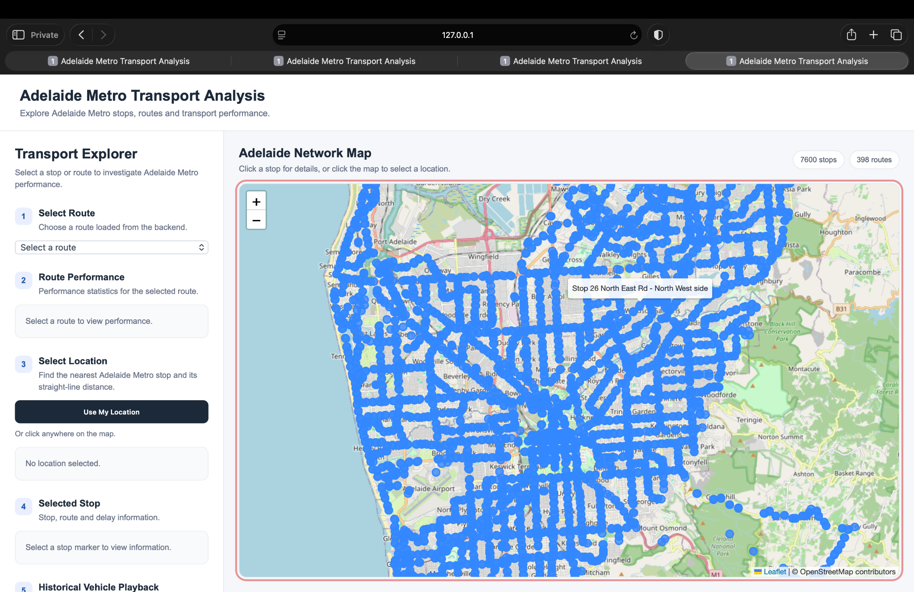
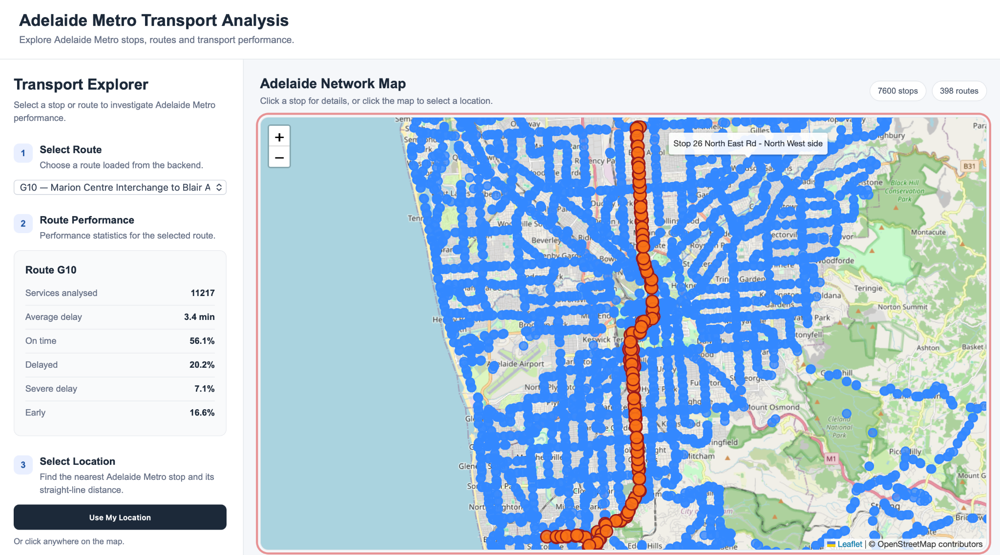
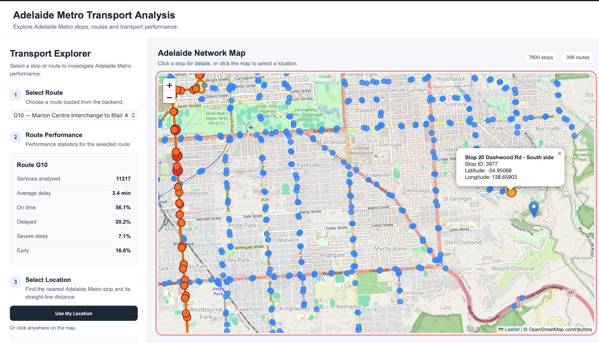
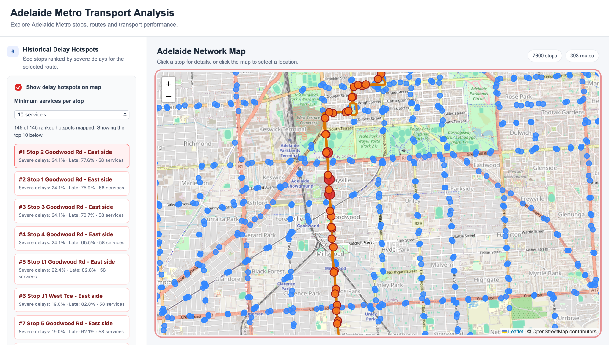
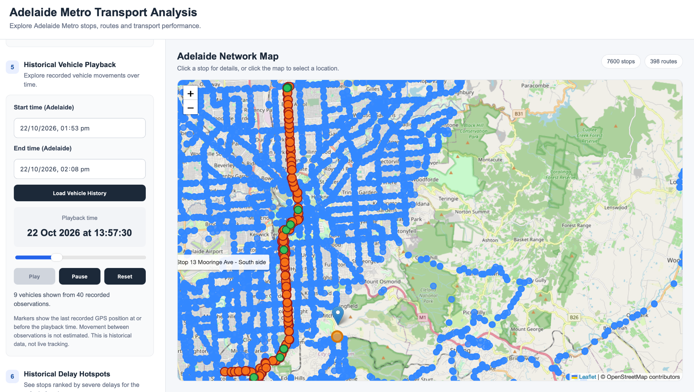
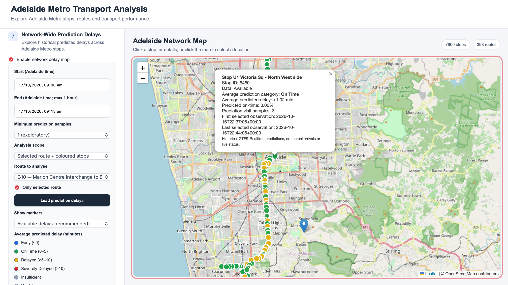

# Frontend Browser Testing Evidence — Adelaide Metro Transport Analysis

**Developer:** Pritish — Frontend Map & User Experience  
**Test date:** 7 November 2026  
**Environment:** Safari Private Window on macOS; local frontend at `127.0.0.1:8000` and Flask backend at `127.0.0.1:5001` (per the testing setup).  
**Scope:** Manual frontend acceptance testing of citywide network map, route and stop selection, nearest-stop metrics, historical hotspots, recorded vehicle playback, and network-wide prediction-delay visualisation.

This report records developer-performed checks and six screenshots supplied from the running application. A screenshot confirms only what is visible in that frame; interactive behaviours such as route switching, playback seeking and geolocation were reported separately by the developer during the manual test sequence. It is not a substitute for automated browser testing.

## Summary

| Area | Manual test outcome | Screenshot evidence | Caveat |
| --- | --- | --- | --- |
| PR01 — Citywide map | Pass (developer-reported) | Figure 1 | Density and counts are visible; performance not benchmarked. |
| PR01 — Route selection | Pass (developer-reported) | Figure 2 | Route switching verified by developer, not by a single image. |
| Stop popup | Visible | Figure 3 | This is a selected-stop popup, **not** the nearest-stop metrics panel. |
| PR04 — Nearest stop and metrics | Pass (developer-reported) | Not directly captured | Frequency/reliability values and geolocation behaviour are not visible in supplied screenshots. |
| PR03 — Historical hotspots | Pass (developer-reported) | Figure 4 | Ranked list and map markers visible; interpretation depends on backend data. |
| PR03 — Historical playback | Pass (developer-reported) | Figure 5 | One playback frame shown; motion, Pause and seeking are reported manual results. |
| PR02 — Prediction-delay overlay | Visual rendering confirmed | Figure 6 | **Timestamp mismatch requires checking** before accepting time-window filtering. |

## Figure 1 — Citywide network map

The Adelaide basemap and widespread blue stop markers are visible. The interface displays **7,600 stops** and **398 routes**. The route dropdown has no selected route in this screenshot. The developer also reported that pan, zoom, stop selection and general responsiveness worked.

## Figure 2 — Route selection and geometry

The route dropdown shows **G10**, with orange highlighted route markers over the blue network stop layer. The route performance panel reports **11,217 services analysed**, **3.4 min average delay**, **56.1% on time**, **20.2% delayed**, **7.1% severe delay** and **16.6% early**. These are values displayed by the application, not independently audited calculations. The developer reported switching to another route and seeing old geometry cleared.

## Figure 3 — Stop selection and popup

The selected stop popup shows **Stop 20 Dashwood Rd – South side**, stop ID **3977**, latitude **-34.95088** and longitude **138.65903**. This supports stop-marker interaction and detail rendering. It does **not** show the nearest-stop distance, scheduled frequency or historical prediction-reliability panel. Those were checked and reported as passing during Test 3, including browser geolocation, but need a dedicated screenshot if visual proof is required.

## Figure 4 — Historical delay hotspots

The hotspot checkbox is enabled with a **minimum of 10 services per stop**. The UI reports **145 of 145 ranked hotspots mapped**, with the top ten listed. The leading entry, **Stop 2 Goodwood Rd – East side**, shows **24.1% severe delays**, **77.6% late** and **58 services**. The map shows orange hotspot/route markers. The developer reported that changing routes clears or replaces stale hotspot results.

## Figure 5 — Historical vehicle playback

The playback window is **22 October 2026, 1:53 pm to 2:08 pm Adelaide time**. The displayed playback clock reads **13:57:30**; the interface reports **9 vehicles shown from 40 recorded observations**. Vehicle markers and Play/Pause/Reset controls are visible. The developer reported that Play, Pause, timeline seeking and switching route/time window worked. The UI correctly states that these are recorded GPS positions, **not live tracking**, and that motion between observations is not estimated.

## Figure 6 — Network-wide prediction-delay overlay

The prediction-delay overlay is enabled for **17 October 2026, 9:00–9:15 am Adelaide time**, with **minimum prediction samples = 1 (exploratory)**, selected-route scope, G10 route and colour-coded categories. The legend identifies **Early (<0)**, **On Time (0–5)**, **Delayed (>5–10)**, **Severely Delayed (>10)** and **Insufficient**. The selected popup reports **Stop U1 Victoria Sq – North West side**, ID **6460**, **On Time**, average predicted delay **+1.02 min**, and **3 prediction visit samples**. The screenshot confirms markers, legend and popup render.

**Follow-up required:** The popup's first/last selected observation timestamps display **2026-10-16 22:37:05+00:00** and **2026-10-16 22:44:05+00:00**. In Adelaide daylight-saving time these correspond to approximately **9:07–9:14 am on 17 October**, so they are actually **inside** the selected 9:00–9:15 am window. The dates differ because the popup displays UTC timestamps. This is not evidence of a filtering bug, but the UI should ideally label these timestamps as UTC or convert them to Adelaide time to avoid confusion. The user has visually demonstrated the overlay, though full empty/error-state behaviour remains untested.

## Manual browser test record

| Test | Actions reported by developer | Result |
| --- | --- | --- |
| 1. Citywide map | Load map; inspect markers; pan/zoom; select stop; check responsiveness | Pass |
| 2. Route selection | Select route; view geometry/performance; switch route; inspect stale lines | Pass |
| 3. Nearest stop | Click map; check nearest stop, distance, scheduled frequency, prediction reliability; change location; test browser geolocation | Pass |
| 4. Historical hotspots | Load ranked hotspot list and map markers; switch route; inspect stale markers | Pass |
| 5. Historical playback | Load recorded observations; Play, Pause and seek; change route/window | Pass |
| Additional: PR02 overlay | Enable prediction-delay view; choose time range and route; inspect coloured markers, legend and popup | Visual display confirmed by screenshot; not a complete error-state test |

## Verification beyond screenshots

- Backend test suite reported **400 passed, 3 skipped**, run with local dataset override environment variables unset.
- `frontend/js/map.js` passed `node --check` after comment-only updates; `git diff --check` showed no whitespace errors.
- PR04 functionality was committed as `918cc04`; final frontend documentation and comments were committed as `a5ca21d` on `feature/S5-network-delay-frontend`.

## Limitations and outstanding checks

1. **Nearest-stop screenshot gap:** Capture a screenshot showing the actual nearest-stop panel, straight-line distance, scheduled departures per hour and prediction reliability/insufficient-data status if a visual artifact is required for every PR04 requirement.
2. **Historical evidence is not actual punctuality:** The prediction-delay overlay and nearest-stop reliability refer to GTFS-Realtime predictions/observations. These should not be presented as measured actual arrivals. The G10 route-performance figures are UI-displayed results and were not independently recalculated here.
3. **Recorded GPS is not live tracking:** Playback is based on stored vehicle positions; no interpolation or continuous movement between observations is established by the screenshots.
4. **Dense marker display:** The citywide screenshot shows considerable overlap at a broad zoom level. Clustering or zoom-dependent display could improve readability, but is not required to claim the basic map loads.
5. **Time display:** The prediction-delay popup uses UTC timestamps while inputs are labelled Adelaide time. The selected sample times are consistent after timezone conversion, but the UI would be clearer if it labelled UTC explicitly or displayed local times.
6. **Not tested in this evidence set:** Console/network inspection, error and empty-data cases, DST boundary inputs, accessibility, cross-browser compatibility, measured rendering latency and reproducibility with other datasets.

## Related design document

See [Pritish — Frontend Map Final Design](pritish-frontend-map-design.md) for architecture, API interactions, UI decisions, technical challenges and broader limitations.
