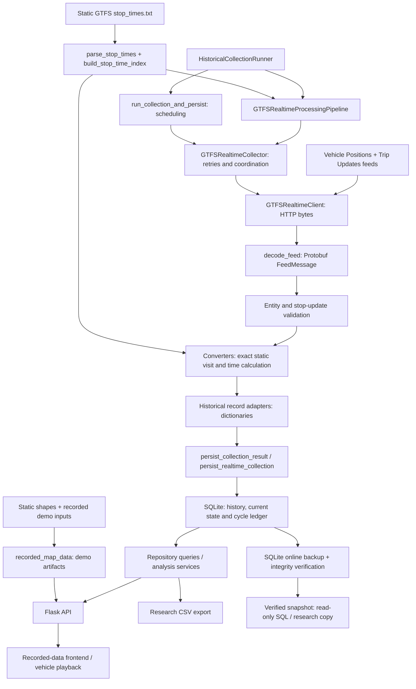

# CASR guide: GTFS processing, historical collection and data access

For CASR researchers, operators and future developers. Reviewed on 27 October
2026 against main `0b67e7f749a833ba937b118cf63c240754a6c2df`, including
SCRUM-268 (PR #69). That review remains the baseline for this guide.
Section 8's performance API contract was updated on 2 November 2026 to document
optional timezone-aware observation-time filters and their local regression
tests; this update does not establish CASR deployment or production acceptance.

**Production evidence boundary:** the October CASR v2 backup failed
`PRAGMA integrity_check` with `database disk image is malformed`. Preserve that
file and obtain a separately verified replacement from CASR; do not use it for
the examples below. Production coverage, sustained reliability and storage
growth remain unverified. **v2.1 remains HOLD.**

Researchers can start at [accessing historical data](#7-accessing-historical-data),
then [API access](#8-available-backend-apis). Operators should use
[Windows operation](#9-windows-operation-and-recovery). Developers should read
the architecture and storage sections before changing processing or analysis.

## 1. System overview

The system combines a static timetable with periodically retrieved realtime
observations, stores selected historical records in SQLite, and exposes query
and analysis functions through Python, CSV tools and a local Flask API.
Collection must run while the observations are available. Restarting later
resumes from the current feed; this system has no historical-feed backfill.

Three different kinds of coverage must be kept separate:

| Coverage | What the existing evidence establishes |
| --- | --- |
| Static network | Validated feed 1710 contains 716 routes, 9,161 stops, 21,691 trips, 804,594 stop-times and 1,763 usable shapes; validity 2026-10-16 to 2027-04-09 |
| Named Adelaide Metro agencies | SCRUM-267 identified 561 routes and 7,693 referenced stops; the full feed also includes regional/school services, so this is not a geographic boundary |
| Recorded browser demo | G10, M44 and 506, 26 September 2026, 09:00–11:00 Adelaide time; map publishing remains tied to these artifacts |
| CASR production history | Not verified from the malformed October backup; static counts and local demonstrations cannot establish collection coverage |

The [SCRUM-268 integration report](../integration/sprint5-gtfs-integration.md)
records feed hashes, validation provenance and the saved snapshot's 58 sequence
conflicts. Feed 1692 covers 2026-08-20 to 2026-10-11 and is not a valid substitute
for October observations. Neither validity dates nor the duplicate-key fix
prove a realtime feed uses the selected static version.

## 2. GTFS data sources

Static GTFS is a set of related CSV tables, normally distributed in a ZIP.
The [GTFS Schedule reference](https://gtfs.org/documentation/schedule/reference/)
defines these files; the right column describes this repository's narrower use.

| File | Purpose | Current use |
| --- | --- | --- |
| `agency.txt` | Operators and their metadata | Used in coverage investigation; no agency table or automatic runtime agency filter |
| `routes.txt` | Route identities and modes | `parse_routes()`; selected fields can populate `routes` |
| `stops.txt` | Stops, stations and coordinates | `parse_stops()`; selected fields can populate `stops` |
| `trips.txt` | Trips linked to route, service and optional shape | `parse_trips()`; runtime collector does not validate trip-to-route membership |
| `stop_times.txt` | Ordered stops and scheduled arrival/departure times | `parse_stop_times()` builds the collector's exact timetable index |
| `calendar.txt`, `calendar_dates.txt` | Weekly services, date range and additions/removals | Read by the separate frequency-analysis script; not loaded into the runtime matching index or historical schema |
| `shapes.txt` | Ordered route geometry points | `extract_shapes()` supports geometry extraction; the artifact publisher enforces the three-route demo manifest |
| `feed_info.txt` | Feed metadata, including version/validity where supplied | Archive provenance evidence; no automatic runtime feed selection |

[Static parsers](../../backend/parsers/static_gtfs.py) preserve identifier strings
(including leading zeros), check required headers and convert selected numeric
fields. They are not a complete GTFS structural validator. The historical
runner loads **only `stop_times.txt`**, once at startup. It does not automatically
populate the static dimension tables, download/refresh a feed or import shapes.
Preserve the original archive and its version/hash for research provenance.

GTFS-Realtime uses Protobuf messages. Its
[reference](https://gtfs.org/documentation/realtime/reference/) distinguishes
Vehicle Positions, Trip Updates and Service Alerts. In this implementation:

- Vehicle Positions supply vehicle coordinates and optional trip/route IDs.
- Trip Updates supply stop arrival estimates matched to the static timetable.
- `GTFSRealtimeClient.fetch_service_alerts()` can retrieve alert bytes, and the
  decoder can parse them. The historical collector has no alert conversion,
  historical record contract, table or API and does not request them each cycle.

The configured feed URLs are under `https://gtfs.adelaidemetro.com.au/v1/realtime/`:
`vehicle_positions`, `trip_updates`, and `service_alerts`. See
[collection settings](../../backend/realtime/config.py) for the actual URLs.

## 3. Processing architecture



| Responsibility | Source and boundary |
| --- | --- |
| Client | [client.py](../../backend/realtime/client.py): one HTTP attempt per fetch, timeout and request error classification |
| Decoder | [decoder.py](../../backend/realtime/decoder.py): `decode_feed()` turns bytes into `FeedMessage`; empty/invalid bytes fail |
| Validation | [validation.py](../../backend/realtime/validation.py): required entity fields and usable stop arrivals |
| Conversion | [gtfs_converter.py](../../backend/services/gtfs_converter.py): shared records, exact visit matching, timezone and delay calculations |
| Coordination | [collector.py](../../backend/realtime/collector.py) and [realtime/pipeline.py](../../backend/realtime/pipeline.py): retrieve, retry, decode and process |
| Historical adapter | [historical_records.py](../../backend/services/historical_records.py): required identifiers, optional values normalised to `None`, numeric types |
| Persistence | [services/pipeline.py](../../backend/services/pipeline.py) delegates to [repository.py](../../backend/database/repository.py): transactional writes |
| Backend access | [app.py](../../backend/api/app.py), repository and analysis services: data-dependent query/analysis responses |

`GTFSRealtimeProcessingPipeline.process_once()` returns
`{"vehicle_positions": [...], "trip_updates": [...]}` and performs **no database
write**. The historical runner uses its collector through
`run_collection_and_persist()`. Call `persist_collection_result()` to cross the
database boundary; processing and storage are deliberately separate.

The matching key is `(str(trip_id), str(stop_id), int(stop_sequence))`.
`build_stop_time_index()` now raises `ValueError` on duplicate normalised keys,
including identical duplicates. Different stop sequences at the same stop
remain distinct. Missing exact keys produce no delay record; there is no
ordinal, global-offset or trip/stop-only fallback.

The converter combines `trip.start_date` with static `arrival_time`, supports
times above 24:00, and uses `ZoneInfo("Australia/Adelaide")`. For example,
`20261021` plus `24:05:00` becomes `2026-10-22T00:05:00+10:30`. Unix observations
are converted using the same timezone; offsets are not hard-coded. The index
does not enforce static feed validity, service calendars or trip-route agreement.

## 4. Historical collection workflow

The [runner](../../backend/services/historical_collection.py) reads command-line
and environment configuration, configures console/optional rotating logs and
acquires its Windows single-instance guard. It loads the stop-time index before
calling `create_tables()` and constructing the processing pipeline. Bad static
data therefore fails startup before schema creation. The schema helper creates
missing tables for a new database and refuses the recognised legacy historical
layout; it is not a production migration or comprehensive integrity validator.

One attempted collection cycle:

1. Fetch and decode Vehicle Positions, then fetch and decode Trip Updates.
   These are sequential requests, not an atomic upstream snapshot. If either
   feed fails before processing completes, no part of that cycle is persisted.
2. Validate and convert entities. Vehicle records require a vehicle ID and a
   position; route/trip IDs are optional. Trip Updates require trip ID, route ID
   and start date. A stop update needs stop ID, nonzero sequence and absolute
   `arrival.time`; delay-only or departure-only updates are not converted.
3. Return adapted dictionaries. Invalid entities and conversion `ValueError`s
   are skipped; valid entities continue. Missing exact stop-time matches produce
   no rows. These checks do not establish complete GTFS-Realtime conformance.
4. Persist both lists, current state and a successful-cycle ledger row in one
   SQLite transaction. An empty but successfully processed cycle can commit a
   ledger row with zero counts.
5. Log counts, then wait the configured polling interval before the next
   attempt. The default is a **60-second delay after work**, so actual start-to-start
   intervals also include HTTP, retry, conversion and database time.

Requests default to 10 seconds timeout, with up to **two retries after the first
attempt** and fixed 5-second retry delays, independently for each feed. Timeout,
retry count/delay, feed URLs and user agent are Python settings injectable via
`GTFSRealtimeCollectionSettings`; the launcher exposes polling via an environment
variable, not separate CLI flags for all of those settings.

| Failure | Behavior in the historical runner |
| --- | --- |
| Connection/timeout, HTTP 408/429 or server error | Collector retries; exhaustion raises `GTFSRealtimeRetryExhaustedError`; scheduler logs, skips and waits before the next cycle |
| Permanent HTTP error, e.g. 403 | No immediate request retry; scheduler catches the request error and attempts a new cycle after its polling wait |
| Empty response / malformed Protobuf / cycle-level `TypeError` or `ValueError` | No HTTP retry for decoding; scheduler logs the processing failure and continues next cycle |
| Invalid entity / unmatched stop update | Skip at entity/update boundary; other valid data may still be stored |
| SQLite setup/write/commit error | Repository rolls back where applicable and re-raises; historical scheduler logs the failed cycle and continues after waiting |
| Startup failure / unhandled exception | CLI logs fatal error and returns 1; duplicate same-session collector returns 2 |
| Interactive `Ctrl+C` | CLI catches `KeyboardInterrupt` and returns 0; restart uses persisted current state |

The low-level `collector.run()` / processing pipeline's `run()` only catch retry
exhaustion and do not persist. The historical scheduler has the broader handling
above; do not interchange their failure contracts. A bounded `--max-cycles 1`
run may return 0 even when its single attempt was handled as a failure. Verify a
completed-cycle log and ledger activity, not exit status alone.

Continuous historical runs retain only the latest successful result in memory;
bounded runs return successful results for their attempted cycles. There is no
raw Protobuf archive or durable queue for a failed cycle. Missed periods cannot
be reconstructed by this collector from a later live feed.

## 5. SQLite database structure

The authoritative DDL is [models.py](../../backend/database/models.py).
`schema_metadata` stores `historical_storage_version = '2'`.

| Table | Important physical columns and meanings |
| --- | --- |
| `vehicle_positions` | `id` integer PK; `vehicle_id` required; optional `trip_id`, `route_id`; `latitude`, `longitude`; optional `timestamp` **TEXT**, normally Adelaide ISO 8601 |
| `trip_updates` | `id` integer PK; required `trip_id`, `route_id`, `stop_id`; `scheduled_arrival` **INTEGER UTC epoch seconds**; signed `delay_seconds`; optional `observed_at` **INTEGER UTC epoch seconds**; `observation_kind` integer |
| `trip_update_current_state` | PK `(trip_id, route_id, stop_id)`; `scheduled_arrival`, `delay_seconds`; optional `last_seen_at`, `last_stored_at` epoch seconds; durable state across restarts |
| `collection_cycles` | `id`; `observed_at`; `vehicle_positions_received`, `trip_updates_received`, `trip_updates_stored`, `trip_updates_suppressed`; one row per successful persistence cycle |
| `routes`, `stops`, `trips`, `stop_times` | Static dimensions, populated separately; `trips.route_id` and `stop_times.trip_id`/`stop_id` support joins |

These are logical relationships; the schema declares **no foreign keys**.
Historical rows have no `collection_cycle_id`, static-feed version or stored
original stop sequence. The current-state key is not one row per stop visit.
Basic route/stop queries can use complete dimensions, but collector startup
alone leaves a newly created database's static dimensions empty.

The transaction is:

```text
BEGIN
  -> insert/deduplicate Vehicle Positions
  -> retain/suppress Trip Updates and update current state
  -> insert collection_cycles row
COMMIT
```

SQLite failures during inserts, ledger writing or commit trigger rollback and
propagate to the caller. Invalid Trip Update timing can also roll back the
whole cycle. Thus successful Vehicle inserts from a failed transaction are not
left behind as a partially committed cycle. Connections close in `finally`.
This boundary does not turn an upstream partial/missing feed into valid data.

Ledger `received` counts mean **converted records handed to persistence**, not
all raw entities or stop updates. Mapping skips occur earlier. The ledger time
is the maximum available record timestamp, falling back to local system time
when no record has one; it is not a dedicated collector execution timestamp.
Failed cycles have no successful ledger row. Gaps/repeated feed times alone
cannot quantify uptime; correlate them with logs and feed freshness.

## 6. Historical storage optimisation and interpretation

The [storage helpers](../../backend/database/historical_storage.py) set the
default checkpoint to **900 seconds (15 minutes)**, configurable by positive
integer `ADELAIDE_METRO_TRIP_UPDATE_CHECKPOINT_SECONDS`. The Windows launcher sets
the same default. Checkpoints depend on advancing observations; they are not a
wall-clock timer that inserts a row every 15 minutes regardless of feed health.

For each `(trip_id, route_id, stop_id)`, compare the state
`(scheduled_arrival, delay_seconds)` in this order:

| Kind | Retention rule |
| --- | --- |
| `0 initial` | No previous state: store |
| `1 change` | Schedule or delay changed: store |
| `3 reappearance` | Same state with a timestamp after an untimed stored state, or observed-time gap from `last_seen_at` at least the checkpoint interval: store |
| `2 checkpoint` | Otherwise, same state with elapsed time from `last_stored_at` at least the checkpoint interval: store |
| Suppressed | Otherwise do not append history; still update current state and successful-cycle metadata |

Last-seen/stored timestamps use the latest available value. Missing observation
times cannot trigger elapsed-time checkpoints. Unique indexes and `INSERT OR
IGNORE` also prevent duplicate stored observations; Vehicle Position uniqueness
uses vehicle, optional trip/route, coordinates and timestamp. The summary's
`trip_updates_suppressed` is received minus inserted, so it can also include a
duplicate insert rejected by the unique index, not just unchanged predictions.

The recorded three-cycle experiment (unchanged predictions, observation offsets
0, +60 and +900 seconds) stored 1,635 / 0 / 1,635 rows. At the last cycle the
last-seen gap is 840 seconds but the last-stored gap is 900 seconds, producing
checkpoints. These are [saved controlled replay results](../integration/sprint5-gtfs-integration.md),
not production coverage. The earlier **81.62% size reduction** is also a
[controlled replay benchmark](../architecture/historical-storage-optimisation.md),
not a verified reduction in the current CASR production database.

The application field `actual_arrival` is a legacy name for the supplied
GTFS arrival estimate. It is reconstructed as schedule plus delay; v2 has no
physical `trip_updates.actual_arrival` or `trip_updates.timestamp` column.
Repository results expose derived `actual_arrival` and map `observed_at` back to
`timestamp`, in Adelaide ISO format. These values do not independently prove a
vehicle actually arrived. Negative delay is an early prediction; zero is a
prediction matching the timetable.

Retained rows are neither independent trips nor complete feed snapshots. The
current backend analysis selects the latest record per
`(trip_id, stop_id, scheduled_arrival)` within its query result; its
`total_services` label therefore counts those selected stop-arrival keys, not
unique completed journeys. The separate reliability CLI aggregates retained
rows directly and reports unique trip IDs separately. Different selection rules
can produce different averages/rates. Document the observation window, timetable
version, selection rule and prediction status with every research output.

## 7. Accessing historical data

### Find and obtain the database

Ask the CASR operator for the **resolved configured path**, collection settings,
collector revision, static version/hash, snapshot time/timezone and relevant
logs. The BAT default is `data\historical\adelaide_metro_history_v2.db` relative
to its application root. Direct Python defaults to
`backend/database/adelaide_metro.db` unless `ADELAIDE_METRO_DATABASE_PATH` is set
before import. Neither example identifies the actual CASR installation path.

For an actively running, healthy collector, use the existing online backup API.
From its application root, with the configured collector interpreter available:

```powershell
$database = (Resolve-Path -LiteralPath (Read-Host 'Existing collector database path')).Path
$backupDirectory = Read-Host 'Separate backup output directory'
.\.venv\Scripts\python.exe -m backend.services.historical_backup --database "$database" --output-dir "$backupDirectory"
if ($LASTEXITCODE -ne 0) { throw 'Backup failed; do not distribute the output' }
```

[`create_sqlite_backup()`](../../backend/services/historical_backup.py) opens the
source with `mode=ro`, uses SQLite's online backup API, refuses an existing
destination, closes the copy and checks `PRAGMA integrity_check`. It prints the
completed path only on success. A failed output may remain; quarantine it and
preserve the source. A timestamp-name collision also fails rather than overwrites.
Use the configured interpreter if it differs from `.venv`.

Record the completed snapshot's SHA-256 (PowerShell `Get-FileHash -Algorithm SHA256`),
size and provenance; check the hash after transfer and integrity before analysis.
Do not copy only the active `.db` file or separate it from required live sidecars.
Do not use `immutable=1` against a live database: it assumes the file cannot
change. The read-only example below needs no immutable setting.

### Open a verified snapshot read-only

This Python example first gates all analysis on integrity and v2 metadata.
Run it against a separate approved snapshot, **never the known malformed backup**.
The route/time parameters are synthetic examples to replace for your study.

```python
from contextlib import closing
from datetime import datetime
from pathlib import Path
import sqlite3

path = Path(input("Verified analysis snapshot path: ")).expanduser().resolve(strict=True)
with closing(sqlite3.connect(path.as_uri() + "?mode=ro", uri=True)) as db:
    db.row_factory = sqlite3.Row
    db.execute("PRAGMA query_only = ON")
    integrity = [row[0] for row in db.execute("PRAGMA integrity_check")]
    if integrity != ["ok"]:
        raise RuntimeError(f"Stop: snapshot integrity failed: {integrity}")
    version = db.execute(
        "SELECT value FROM schema_metadata WHERE name = 'historical_storage_version'"
    ).fetchone()
    if version is None or version[0] != "2":
        raise RuntimeError("Stop: this example requires historical storage v2")
    print([row[0] for row in db.execute(
        "SELECT name FROM sqlite_master WHERE type = 'table' ORDER BY name"
    )])
    parameters = {
        "route_id": "DOC1", "stop_id": "S-DOC",
        "start_epoch": int(datetime.fromisoformat("2026-10-21T08:00:00+10:30").timestamp()),
        "end_epoch": int(datetime.fromisoformat("2026-10-21T09:00:00+10:30").timestamp()),
    }
    rows = db.execute("""
        SELECT trip_id, route_id, stop_id, scheduled_arrival,
               delay_seconds, observed_at, observation_kind
        FROM trip_updates
        WHERE route_id = :route_id AND stop_id = :stop_id
          AND observed_at >= :start_epoch AND observed_at < :end_epoch
        ORDER BY observed_at, id LIMIT 100
    """, parameters).fetchall()
    print([dict(row) for row in rows])
```

An SQLite exception during integrity checking also stops the example. Do not
repair, migrate, run `create_tables()`, `VACUUM` or resume scans on a failed input.
Ask for source-side verification and a newly verified online backup.

### Small SQL queries

Use the same read-only connection after integrity succeeds. Bind parameters
with `db.execute(sql, parameters)` rather than concatenating values.
Times below are half-open `[start, end)` to avoid overlap between adjacent windows.

Recent successful cycles (no time parameters):

```sql
SELECT id, observed_at, vehicle_positions_received, trip_updates_received,
       trip_updates_stored, trip_updates_suppressed
FROM collection_cycles ORDER BY id DESC LIMIT 10;
```

Vehicle movement observations, with `route_id`, `start_time`, `end_time` bound
to `DOC1`, `2026-10-21T08:00:00+10:30`, `2026-10-21T09:00:00+10:30` in the example:

```sql
SELECT vehicle_id, trip_id, route_id, latitude, longitude, timestamp
FROM vehicle_positions
WHERE route_id = :route_id
  AND julianday(timestamp) >= julianday(:start_time)
  AND julianday(timestamp) < julianday(:end_time)
ORDER BY julianday(timestamp), id LIMIT 100;
```

Retained prediction observations, using the epoch parameters from Python:

```sql
SELECT trip_id, stop_id, datetime(observed_at, 'unixepoch') AS observed_utc,
       datetime(scheduled_arrival + delay_seconds, 'unixepoch') AS predicted_arrival_utc,
       delay_seconds, observation_kind
FROM trip_updates
WHERE route_id = :route_id AND stop_id = :stop_id
  AND observed_at >= :start_epoch AND observed_at < :end_epoch
ORDER BY observed_at, id LIMIT 100;
```

`datetime(..., 'unixepoch')` displays UTC. Use Python `ZoneInfo("Australia/Adelaide")`
for local presentation; the SQLite `localtime` modifier follows the host's timezone.
NULL timestamps do not match these bounded queries. Query `... WHERE observed_at
IS NULL` or `timestamp IS NULL` separately when assessing missing-time records.

### Existing CSV and research tools

The [Sprint 5 database handover](../architecture/database-handover-sprint5.md)
describes the existing export, verification and frequency tools. They are reused
here. Use a **working copy of a verified snapshot** for application-based access:
export/reliability scripts and Flask use normal SQLite connections, not enforced
URI read-only mode. Their current query paths do SELECTs, but do not claim
read-only isolation. Keep the original verified snapshot and use unique CSV paths;
existing export destinations can be overwritten. Large exports load matching
records into memory, so start with bounded route/time windows.

```powershell
$researchDb = (Resolve-Path -LiteralPath (Read-Host 'Working copy of a verified v2 snapshot')).Path
$csvOutput = Read-Host 'New CSV output path'
if (Test-Path -LiteralPath $csvOutput) { throw 'Choose a new output file' }
python scripts/export_historical_data.py --database "$researchDb" trip-updates --route DOC1 --stop S-DOC --start-time '2026-10-21T08:00:00+10:30' --end-time '2026-10-21T09:00:00+10:30' --output "$csvOutput"
```

`vehicle-positions` is the other subcommand, with `--vehicle`, `--route`,
`--start-time`, `--end-time` and required `--output` (no `--stop`). Repository/CSV
time bounds are **inclusive at both ends**. Vehicle CSV filtering compares ISO
TEXT lexically: use timestamps with the same representation/offset as stored,
or the instant-based SQL/API above for mixed offsets or daylight-saving windows.

`python scripts/verify_historical_database.py --database "$researchDb" --integrity`
uses `mode=ro` and a read transaction, but its optional check is
`quick_check(1)` **after coverage queries**. It is not the initial integrity gate
for an unknown/suspect backup; use the earlier full integrity check first.

`scripts/summarise_service_reliability.py` accepts `--database`, `--static-gtfs`,
`--route`, `--start-time`, `--end-time`, and optional `--output`. It counts the
first scheduled departure per trip in a single Adelaide date window and
aggregates retained prediction rows for the observation-time window. Calendar
files are read by this offline tool, not by the collector. If its active-service
set is empty, current `get_route_trip_ids()` selects all route trips; missing
calendars or no-service dates can therefore produce misleading frequencies.
Previous-service-day trips with times above 24:00 are not included in a general
cross-day calculation. Validate those cases separately before research use;
these source issues are documented here without changing application logic.

## 8. Available backend APIs

The [Flask routes](../../backend/api/app.py) provide GET endpoints below. Configure
`ADELAIDE_METRO_DATABASE_PATH` before starting a fresh Python process. There is
no authentication/access-control layer in this prototype; use local access and
CASR-approved controls before any wider hosting. `CORS(app)` is enabled.

For a working copy of a verified snapshot, from the repository root with
`requirements.txt` installed:

```powershell
$env:ADELAIDE_METRO_DATABASE_PATH = (Resolve-Path -LiteralPath (Read-Host 'Research database working copy')).Path
python -m flask --app backend.api.app run --host 127.0.0.1 --port 5000
```

This starts the API only. It does not initialise tables, import dimensions or
start the collector. The ordinary connection helper can create an empty database
if a path is wrong; keep the existence check. No server was started for this
documentation verification; examples were executed through Flask's test client.

| GET endpoint | Parameters and actual behavior |
| --- | --- |
| `/api/routes` | Static route list from the selected DB; no demo allowlist, filter or pagination |
| `/api/stops` | Static stop list from the selected DB; no filter or pagination |
| `/api/stops/<stop_id>` | Stop details; unknown stop returns 404 |
| `/api/stops/<stop_id>/routes` | Join through stop-times/trips/routes; unknown/unlinked stop returns `[]` |
| `/api/routes/<route_id>/vehicle-positions` | Required offset-aware `start_time`, `end_time`; optional `limit` (default 500, 1–1000), `offset` (default 0); half-open interval, deterministic order, `next_offset`; missing route dimension returns 404, invalid parameters 400 |
| `/api/routes/<route_id>/performance` | Route prediction analysis; optional offset-aware `start_time`, `end_time`; inclusive observation-time bounds; invalid timestamp/range 400, no result 404 |
| `/api/stops/<stop_id>/performance` | Stop prediction analysis across routes; same optional time filters and 400/404 behavior as route performance |
| `/api/analysis/hotspots` | Optional `route_id`, `stop_id`, `start_time`, `end_time`, `min_services` (default 10); inclusive observation-time bounds via repository; returns `hotspots` and `total_hotspots` |
| `/api/routes/<route_id>/map-data` | Recorded demo artifacts configured by `ADELAIDE_METRO_DEMO_MAP_DATA_PATH`; publisher supports G10/M44/506 only; absent route 404, unavailable/inconsistent artifacts 503 |

Database errors return JSON 500. There is no dedicated trip-detail, raw Trip
Update history, Service Alerts, health, backup or CSV-download HTTP endpoint.
Use repository/CSV/direct SQL for raw prediction history. Hotspot `min_services`
must be positive; the current handler defaults to 10 for non-integer input
instead of rejecting it. Keep queries small: performance/hotspot paths are not
paginated and may scan substantial history.

Performance filters apply to the prediction's **observation time** (`observed_at`),
not scheduled or actual arrival time. Either bound may be supplied alone. Both
ends are inclusive, matching the existing Trip Update/hotspot convention;
equal bounds select observations at that instant. Vehicle history retains its
separate end-exclusive convention. No existing interval convention is changed.
Fractional-second query bounds are compared without truncation against the
stored whole-second observations. Offsets are compared as actual instants:
use `+09:30` for September Adelaide times and `+10:30` during October daylight
saving, or send UTC (`Z`). URL-encode a literal `+` as `%2B` (or use a query
parameter encoder). Naive dates/times and explicitly empty filters return 400.

For example, a route request for the closed October observation window is:

```text
GET /api/routes/G10/performance?start_time=2026-10-21T08%3A00%3A00%2B10%3A30&end_time=2026-10-21T09%3A00%3A00%2B10%3A30
```

A successful response retains the existing metric fields (including
`total_services` and `average_delay`). A valid window with no matching records
returns the existing `404 {"error":"Route performance not found"}` (or
`Stop performance not found`), without falling back to all history or inventing
zero delay. Omitting both filters retains all-history behavior. These remain
prediction aggregates: the latest prediction per scheduled stop visit is
selected **within the filtered observations**. Sample counts do not establish
completed trips or actual observed arrivals. Stop performance remains across
all routes at the stop; this change adds no route filter to that endpoint.

Frontend callers must send the selected window explicitly; this Backend change
does not wire the playback controls into performance/hotspot requests or fix
the frontend's fixed-offset date parsing. When using the same two timestamps
for vehicle playback and analysis, remember that analysis includes an
observation exactly at `end_time`, while vehicle playback excludes it.

The following verified response is **synthetic**: `DOC1`, `0001`, `S-DOC` and
`V-DOC` are documentation fixture IDs, not a supplied CASR dataset. Real requests
must use IDs and dates present in the selected research copy.

```powershell
Invoke-RestMethod 'http://127.0.0.1:5000/api/stops/S-DOC'
Invoke-RestMethod 'http://127.0.0.1:5000/api/routes/DOC1/vehicle-positions?start_time=2026-10-21T08%3A00%3A00%2B10%3A30&end_time=2026-10-21T09%3A00%3A00%2B10%3A30&limit=1&offset=0'
Invoke-RestMethod 'http://127.0.0.1:5000/api/analysis/hotspots?route_id=DOC1&min_services=1'
```

The stop request returns:

```json
{"stop_id":"S-DOC","stop_name":"Documentation stop","stop_lat":-34.9,"stop_lon":138.6}
```

The vehicle-history request returns:

```json
{"route_id":"DOC1","start_time":"2026-10-21T08:00:00+10:30","end_exclusive":"2026-10-21T09:00:00+10:30","limit":1,"offset":0,"next_offset":null,"positions":[{"id":1,"vehicle_id":"V-DOC","trip_id":"0001","route_id":"DOC1","latitude":-34.9,"longitude":138.6,"timestamp":"2026-10-21T08:00:00+10:30"}]}
```

Encode `+` as `%2B` in URL timestamps, as above. Offset pagination is intended
for a fixed snapshot; paging an actively changing DB can produce unstable pages.
The historical vehicle endpoint can serve other routes when dimensions and
observations exist, while the current map publisher/frontend workflow remains
demo-specific. See the [recorded map contract](../integration/recorded-demo-map-data.md).

### Research applications and limits

| Question | Available approach | Interpretation boundary |
| --- | --- | --- |
| Where were vehicles observed? | Vehicle SQL/CSV or paginated route history | Observations are discrete; gaps are not measured trajectories or proof of service cancellation |
| What delays were predicted for a route/stop? | Filtered Trip Update SQL/CSV, route/stop performance, hotspots | Choose observation window and selection rule; predictions are not confirmed arrivals |
| What was punctuality? | Existing categories: early <0; on time 0–5 min; delayed >5–10; severe >10 | A prediction-based indicator; validated actual-arrival/event inference is future work |
| How frequent was scheduled service? | Static timetable and frequency CLI | Validate calendar/no-service and cross-day cases; realtime row counts are not frequency |
| Can researchers replay a route? | Recorded vehicle endpoint plus existing frontend | Complete geometry/artifact publishing beyond the demo and coverage verification remain separate work |

## 9. Windows operation and recovery

Use the [Windows deployment guide](../deployment/windows-historical-collector.md)
for installation, BAT and Task Scheduler fields, and the
[existing-v2 operations handover](../deployment/casr-v2-operations-and-handover.md)
for safe updates, backup, rollback and operator responsibilities. These are
instructions; actual CASR scheduler, account, reboot and sustained-operation
settings have not been independently verified. They do not override the release HOLD.

Python 3.12 is the documented deployment baseline. `requirements-collector.txt`
contains `gtfs-realtime-bindings==2.2.0`, `protobuf==7.36.0`, and `tzdata`;
SQLite/HTTP/logging use the standard library. Flask and pytest are not collector
dependencies. Use `requirements.txt` for backend/API development.

| Variable | BAT default relative to application root |
| --- | --- |
| `ADELAIDE_METRO_PYTHON` | `.venv\Scripts\python.exe` |
| `ADELAIDE_METRO_STATIC_GTFS_PATH` | `data\static_gtfs` containing `stop_times.txt` |
| `ADELAIDE_METRO_DATABASE_PATH` | `data\historical\adelaide_metro_history_v2.db` |
| `ADELAIDE_METRO_LOG_PATH` | `logs\historical_collector.log` |
| `ADELAIDE_METRO_POLLING_INTERVAL_SECONDS` | `60` |
| `ADELAIDE_METRO_TRIP_UPDATE_CHECKPOINT_SECONDS` | `900` |

For an operator-approved smoke run with no other writer:
`.\scripts\start_historical_collector.bat --max-cycles 1`.
Continuous operation uses the same launcher without `--max-cycles`, through one
designated scheduled task. Preserve the actual existing absolute DB path during
updates; changing installation directory with defaults can select a new empty DB.
Refresh static files during maintenance and restart to rebuild the index;
retain the prior archive. Do not substitute feed 1692 for October.

Logs contain timestamps, levels, module names, retries, skips, persistence counts
and shutdown; raw feed payloads are not logged. File rotation is 5 MiB with five
older files. Check completed-cycle messages, feed timestamp freshness, ledger
activity, storage space and errors together. An unchanged Trip Update count or
a running process alone does not establish collection health.

Interactive `Ctrl+C` is handled; a programmatic `stop_event` is supported by the
historical loop. There is no unattended CLI stop-control channel. Task Scheduler
**End** can terminate abruptly and is not a graceful stop. The mutex protects
the same Windows session only; use one task/account and prevent other writers.
An at-startup trigger does not configure firmware power restoration or stop the
machine sleeping. Obtain actual client restart evidence.

For recovery, preserve the original and any sidecars, coordinate stopping all
writers, restore a verified snapshot to a different path and verify integrity,
schema and counts before one collector resumes. Report the recovery point and
potential history loss. Do not repair or overwrite the known malformed backup.
For an existing v2 deployment, retain its v2 database; the new-database instruction
in older rollout material applies to legacy-to-v2 transition, not routine updates.

## 10. Troubleshooting

| Symptom | First useful check / action |
| --- | --- |
| Startup cannot find Python/static data | Check resolved interpreter, required dependencies and `stop_times.txt`; use launcher exit/log output |
| `Duplicate static stop-time key` | Preserve the archive/hash and inspect the identified tuple; obtain corrected static data, do not deduplicate silently |
| Collection completes but no Trip Updates retained | Compare mapping coverage, message timestamps, received/stored/suppressed counts and checkpoint policy |
| Permanent HTTP failure repeats each polling cycle | Correct upstream access/configuration; immediate retries are disabled for such errors but future cycles still run |
| Database locked or repeated persistence failures | Inspect competing writers, permissions, disk space and logs; the successful-cycle ledger cannot record failed transactions |
| API routes/stops empty or route history 404 | Confirm selected DB and loaded static dimensions; collection does not populate them |
| Map-data 404/503 | Check route is in the recorded artifact and artifacts are configured/consistent; basic static coverage does not publish map-data |
| Integrity exception / non-`ok` | Stop analysis, preserve source and failed output, request source verification and a separately verified backup |
| Frequency output on a no-service date | Known empty-calendar-set selection issue; do not use that result as validated frequency |
| No restart after outage | Verify actual task account/trigger/permissions and machine power settings with CASR; local tests cannot prove production recovery |

## 11. Known limitations and evidence status

| Status | Scope |
| --- | --- |
| Implemented and verified locally | Parsing, exact-key duplicate rejection, injected-feed processing, transactional v2 retention, online backup, synthetic SQL/CSV/API examples and recovery regression tests |
| Implemented; production validation incomplete | Collector deployment, restart/current-state behavior, checkpoint retention, research exports, historical vehicle queries and analysis |
| Blocked / unverified | October CASR backup integrity, actual Adelaide-wide historical coverage, multi-day collection reliability, sustained disk growth, client scheduler/reboot/monitoring evidence and v2.1 release |
| Not implemented comprehensively | Runtime feed-version/calendar/trip-route validation, Service Alert history, citywide map publication, actual-arrival confirmation, historical backfill, production monitoring/alerts and API authentication |

The [database team's Sprint 5 handover](../architecture/database-handover-sprint5.md)
reports a separate four-cycle verification. Its figures must not be attributed
to the malformed CASR backup. The [SCRUM-268 report](../integration/sprint5-gtfs-integration.md)
records the saved 1710 mismatch evidence; exact matching remains required.
Direct state tracking omits visit sequence, so repeated visits require care in
longitudinal analyses. Export connection mode, vehicle TEXT filtering, frequency
calendar handling and prototype API validation are documented limitations, not
changes made by this task.

## 12. Future development and handover checks

1. Obtain a source-verified CASR snapshot and logs, pass integrity first, then
   establish coverage/reliability/growth with explicit provenance.
2. Resolve producer/static sequence semantics before changing exact matching.
   Add reviewed feed-version, route/trip/service/calendar context and preserve
   source provenance in future historical designs.
3. Define research observation units and arrival evidence. Review repeated visits,
   prediction selection and frequency calendar/cross-day behavior before drawing
   service-level conclusions; make read-only research access explicit in tooling.
4. Extend geometry publishing and frontend contracts beyond the recorded demo
   separately. Full static data and generic queries are prerequisites, not
   evidence of full historical collection.
5. CASR should record ownership of scheduled tasks, storage/backup retention,
   monitoring, dependency maintenance and recovery approvals. Future developers
   should run relevant temporary-database and injected-feed tests before changes.

SCRUM-269 changes documentation only. Its SQL/Python snippets, synthetic response
examples, backup/export/verification commands and repository links are checked
against this revision; runtime and deployment acceptance still require the
evidence above. Keep code behavior, local fixture verification and production
release approval as distinct handover records.

Verification for this documentation used Python 3.12.4: the extracted read-only
Python example, all three SQL blocks, both full JSON response examples, the
nine-endpoint inventory and six bounded CLI invocations passed on fresh synthetic
fixtures. All 51 relative Markdown links resolved, including section anchors.
The existing focused suite passed **121 tests** across integration, time edges,
runner/deployment, reliability, storage, API, processing pipeline and analysis.
No application server, continuous live collector, production migration or CASR
database was used. Mermaid structure was reviewed in source; rendered layout
was not part of automated verification.
