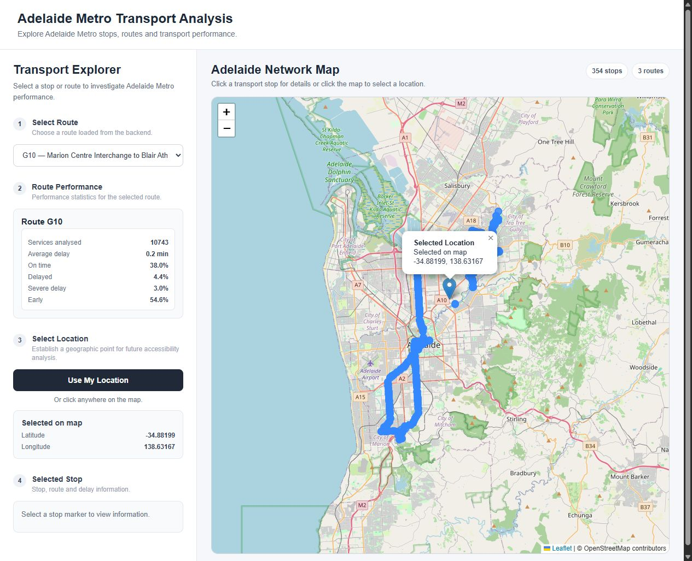

# SCRUM-234 — E2E integration and 19 October demo

Verified 15 October 2026 on Windows / Python 3.12. Main was fast-forwarded to
`904910e0251ce38b63909098065e54c87cd0d010` (PR #52). SCRUM-232 commit
`e9ab417eb3638b23aaf780e0e8b75c442ba05e2a` is an ancestor of main.
The earlier teammate report in `docs/testing/sprint4-recorded-data-integration-test-report.md`
is useful prior evidence; the checks below were run separately against current main plus this branch.

## Architecture and boundaries

- Path A: controlled HTTP response bytes → real GTFS client → protobuf decoder →
  validation → conversion/static stop-time lookup → delay → v2 transaction →
  repository → vehicle-history API. Only HTTP is mocked, not internal stages.
- Path B: real September SQLite demo **copy** → repository/analysis → Flask
  test-client → geometry contract and paginated vehicle-history API.
- Browser: unchanged existing frontend → local HTTP Flask server using another
  disposable demo copy. Browser rendering is tested separately from API responses.

The demo DB does not contain original raw protobuf. Path A's generated protobuf
is controlled test input, not claimed to be original CASR input. No live feed
requests, indefinite collector, production DB changes, deployment changes or Jira updates.
No full repeat of ID/static integrity validation or C05 reliability work.

## Data and configuration

Demo DB:
`D:\Adelaide study\2026\ICT Capstone Project\CASR historical data\analysis\demo_dataset\adelaide_metro_demo.db`

Map directory:
`D:\Adelaide study\2026\ICT Capstone Project\CASR historical data\analysis\demo_map_data`

Map directory must contain `route-shapes.geojson`, `stops.geojson`, `trip-map.json`,
`manifest.json`. Static feed is official version 1692; no regeneration required.
Observation window is **26 September 2026, [09:00,11:00) Australia/Adelaide (+09:30)**.
Do not substitute the current date or October's daylight-saving offset.

The real demo SHA-256 before/after verification was unchanged:
`735de9404b6fe46d52fe0b102004e6993815157b8f5905341afbf9cada465aa2`.
Original 5.59 GiB CASR DB and static files were not opened for writes.
The demo's collection ledger represents import timestamp groups, not original CASR
poll success telemetry. `actual_arrival` is reconstructed prediction time, not
proof the bus physically arrived; delay is relative to the scheduled arrival.

## Setup and launch (PowerShell, repository root)

Use an existing project environment with Flask, flask-cors, GTFS bindings,
tzdata, jsonschema and pytest. If necessary create `.venv`, activate it and
install `requirements.txt` plus `pytest` according to the project setup.

```powershell
Set-Location 'D:\Adelaide study\2026\ICT Capstone Project\git hub clone\adelaide-metro-analysis'
$demoSource = 'D:\Adelaide study\2026\ICT Capstone Project\CASR historical data\analysis\demo_dataset\adelaide_metro_demo.db'
$mapData = 'D:\Adelaide study\2026\ICT Capstone Project\CASR historical data\analysis\demo_map_data'
python -m backend.services.e2e_demo_check --database "$demoSource" --map-data "$mapData"
```

This is the **tested offline fallback**: prints real observations, sample Trip
Updates/delays, shape counts, API results and original DB hash. It makes a temporary
copy, restores configuration and removes its temporary directory automatically.
It is a terminal/JSON demonstration, not a new graphical playback application.
It needs no Leaflet, map tiles, live GTFS or private production files beyond the
already prepared demo artifacts. Do not run Python with `-O`: verification uses assertions.

For the browser demo, in the same terminal:

```powershell
$demoRun = Join-Path $env:TEMP ('adelaide-demo-' + [guid]::NewGuid().ToString('N'))
New-Item -ItemType Directory -Path "$demoRun" | Out-Null
Copy-Item -LiteralPath "$demoSource" -Destination (Join-Path $demoRun 'demo.db')
$env:ADELAIDE_METRO_DATABASE_PATH = Join-Path $demoRun 'demo.db'
$env:ADELAIDE_METRO_DEMO_MAP_DATA_PATH = $mapData
python -m flask --app backend.api.app run --host 127.0.0.1 --port 5000 --no-reload
```

Set environment variables **before importing/starting Flask**. Do not run the
collector or create/seed tables against the source DB. In a second terminal at
the repository root, using the same environment:

```powershell
python -m http.server 8000 --bind 127.0.0.1
```

Open `http://127.0.0.1:8000/frontend/`. Existing JS hardcodes backend port 5000.
Check ports are free; do not terminate someone else's server. Stop both local
servers with Ctrl+C afterwards. Only the disposable copy needs cleanup.

## Verified endpoints and real results

| Route | Vehicle repository/API rows | Retained updates | Shapes | Shape points |
| --- | ---: | ---: | ---: | ---: |
| G10 | 741 | 10,743 | 3 | 1,232 |
| M44 | 793 | 7,319 | 3 | 1,381 |
| 506 | 258 | 4,194 | 2 | 916 |
| Total | 1,792 | 22,256 | 8 | 3,529 |

HTTP 200: `/api/routes`, `/api/stops`, all three
`/api/routes/<route>/performance`, `/api/routes/<route>/map-data`, and
`/api/routes/<route>/vehicle-positions` with valid filters. Representative
stop routes/performance also returned 200 (100618, 100083, 100308).
Every reconstructed update arrival matched scheduled time + delay seconds.
All paginated vehicle IDs exactly matched repository results, without duplicates.
Map responses passed the shared JSON schema. Unknown map route: 404;
missing map files: 503. This reuses SCRUM-232's validated mapping artifacts rather
than re-reading the full static feed.

### New bounded vehicle-history contract

```powershell
$query = @{ start_time='2026-09-26T09:00:00+09:30'; end_time='2026-09-26T11:00:00+09:30'; limit=200; offset=0 }
Invoke-RestMethod 'http://127.0.0.1:5000/api/routes/G10/vehicle-positions' -Body $query -Method Get
Invoke-RestMethod 'http://127.0.0.1:5000/api/routes/G10/map-data'
Invoke-RestMethod 'http://127.0.0.1:5000/api/routes/G10/performance'
```

Use URLSearchParams in JS (literal `+` offsets must be encoded, not concatenated
unescaped). `start_time` and `end_time` are required, offset-aware ISO timestamps;
interval is half-open `[start,end)`. Offset-equivalent UTC values also work.
`limit` defaults 500, maximum 1000; `offset` defaults 0. Response:

```json
{"route_id":"G10","start_time":"...","end_exclusive":"...","limit":200,"offset":0,"next_offset":200,"positions":[{"id":1,"vehicle_id":"1828","trip_id":"1135917","route_id":"G10","latitude":-35.0236,"longitude":138.5699,"timestamp":"2026-09-26T09:00:43+09:30"}]}
```

Follow `next_offset` until null. Known route/empty window returns 200 with an empty
array; unknown route 404; invalid/missing/naive/reversed time, limit/offset or
unsupported query arguments return 400. Results sort by timestamp then row ID.
Pagination targets a fixed recorded DB, not a changing live collection. There is
no invented frontend vehicle format: this is the newly supplied backend contract.
Trip Update history is available through existing repository/fallback, not a new
HTTP endpoint. Existing performance endpoints do not yet take time filters.

## Browser findings and exact frontend handover

Real smoke test on 15 October: page loaded, Leaflet/OSM tiles rendered, displayed
354 stop markers / 3 routes. G10, M44 and 506 selected successfully:

| Route | UI observation count | Average delay | On-time |
| --- | ---: | ---: | ---: |
| G10 | 10,743 | 0.2 min | 38.0% |
| M44 | 7,319 | -0.7 min | 29.4% |
| 506 | 4,194 | 2.1 min | 67.3% |

Manual map-click location selection displayed coordinates. A controlled stop of
the test-owned Flask server then selecting M44 visibly displayed
`Unable to load route performance.` This is a verified connection-failure path,
not a claim that every 404/503 UI state was tested. Stop detail-click regression
was previously demonstrated in the teammate report; this run confirmed marker
rendering but did not repeat that detail selection. No geolocation permission was granted.



| Contract / component | Current compatibility | Frontend owner's next work |
| --- | --- | --- |
| Routes/stops/performance | Consumed by existing JS | Keep existing endpoints |
| Geometry/variants | API ready; **not drawn** by frontend | Fetch map-data on route selection, render all variants or an explicit shape/trip selector; clear old layers |
| GeoJSON | `[longitude,latitude]` | Use `L.geoJSON`; swap to `[latitude,longitude]` only for direct Leaflet markers/polylines |
| Stops | Existing page loads all 354 | Optional route-specific stop layer from map-data; preserve many-to-many relationships |
| Vehicles | API ready; **no vehicle rendering or expected format in existing JS** | Fetch every history page; join trip_id to map-data trip/shape; convert coordinates to Leaflet markers |
| Historical timeline | **No playback controls implemented** | Explicit September window, offset-aware times, play/pause/seek and latest observation per vehicle at cursor; define stale/gap policy, do not treat every row as concurrent/live |
| Recorded banner | **Missing** | Visible `Recorded Historical Data — September 2026` plus 26 Sep 09:00–11:00 Adelaide; never imply current live data |
| Metric labels | UI says “Services analysed” | Relabel as retained prediction observations, not distinct trips/completed services; suppression changes count weighting |
| API failures | Route connection error visible | Add visible map/history 400/404/503 and empty-window handling when those calls are integrated |

No frontend source was changed. Geometry/variant rendering, vehicle markers and
playback cannot be marked passed merely because their APIs succeed. Existing
`frontend/index.html` loads Leaflet 1.9.4 JS/CSS from unpkg, and map.js loads OSM
tiles: **browser map needs network/cache**. The tested fallback is offline.

## Regression results and review

`python -m pytest backend/tests tests -q`: **245 passed in 35.26 seconds**
on the final source, including the oversized-pagination-offset regression case.
14 new focused cases cover HTTP→protobuf→temporary v2→repository/API, filtering,
arrival/timezone consistency, validation counts, unchanged suppression, pagination,
offset-equivalent bounds, empty/unknown results, bad filters and failed HTTP/decode
with no partial persistence. Existing map-data and real fallback checks cover
recorded geometry compatibility and 404/503. No retry-stress duplication.
Do not run the legacy manual `backend/database/test_repository.py` against a real
configured DB: it writes at import time and is outside the isolated test directories.

Confirmed gap fixed: no route/time vehicle-history HTTP interface existed.
No existing frontend rendering defect was fixed; missing features are explicitly
handed over. Backend integration is review-ready; graphical playback acceptance
remains pending frontend integration, not silently declared complete.

## Recommended Monday demo order

1. Announce recorded September window (until banner is added, say it verbally).
2. Run offline fallback; show per-route counts and a real early/late Trip Update.
3. Show map-data JSON: variants, coordinates, trip/shape relationship; clarify this
   proves geometry availability, not route-line drawing in today's UI.
4. Show paginated vehicle-history API and real vehicle/trip/time fields.
5. Start existing browser view; select G10 → M44 → 506, show stops/statistics.
6. Only show graphical route/vehicle/playback additions after frontend owners
   implement and smoke-test them. Re-run this check after any merges.

The 19 October **backend + existing stop/statistics demo is feasible** with tested
offline fallback. Full graphical recorded playback is not ready today; the banner,
route shapes, vehicle rendering and playback are the explicit remaining blockers.
